# ETL Segunda Entrega — Huella de Carbono en Hogares Colombianos (ODS 12)

**Curso:** ETL (G01) · Universidad Autónoma de Occidente · Ingeniería de Datos e Inteligencia Artificial

> Segunda entrega del proyecto de ETL. Esta documentación sigue las 25 secciones del enunciado; los números salen del Data Warehouse tras la corrida final (sección 18) y cada supuesto está en [`docs/supuestos_y_trazabilidad.md`](docs/supuestos_y_trazabilidad.md).

## 1. Problema y objetivo analítico

Estimar y caracterizar la huella de carbono residencial de los hogares colombianos (ODS 12) con la ECV 2025 del DANE
y, en esta entrega, explicar parte de la variación del consumo eléctrico con la temperatura oficial del IDEAM.

## 2. Línea base de la Primera Entrega y enlace al repositorio

**Repositorio de la primera entrega (se conserva intacto):** https://github.com/dianapanesso/etl-proyecto-huella-carbono

**Qué se construyó en la primera fase.** Un Data Warehouse dimensional en MySQL con los microdatos de la ECV 2025 del DANE (único origen) y factores oficiales de emisión, para estimar la **huella de carbono residencial anual** de los hogares colombianos (ODS 12). Los gastos de energía y de combustible de cocina se convertían en kWh y en emisiones mediante tarifas, precios y factores declarados como supuestos. La primera fase respondía cinco requisitos (R1–R5) con consultas SQL sobre el DW.

**Grano declarado:** una fila de hechos por hogar encuestado, identificado por `DIRECTORIO` + `SECUENCIA_P`. La segunda entrega conserva este grano.

**Modelo dimensional previo:** esquema en estrella con una tabla de hechos (`fact_huella_carbono`) y cuatro dimensiones (`dim_hogar`, `dim_ubicacion`, `dim_combustibles`, `dim_tarifas`). No tenía ninguna variable de clima.

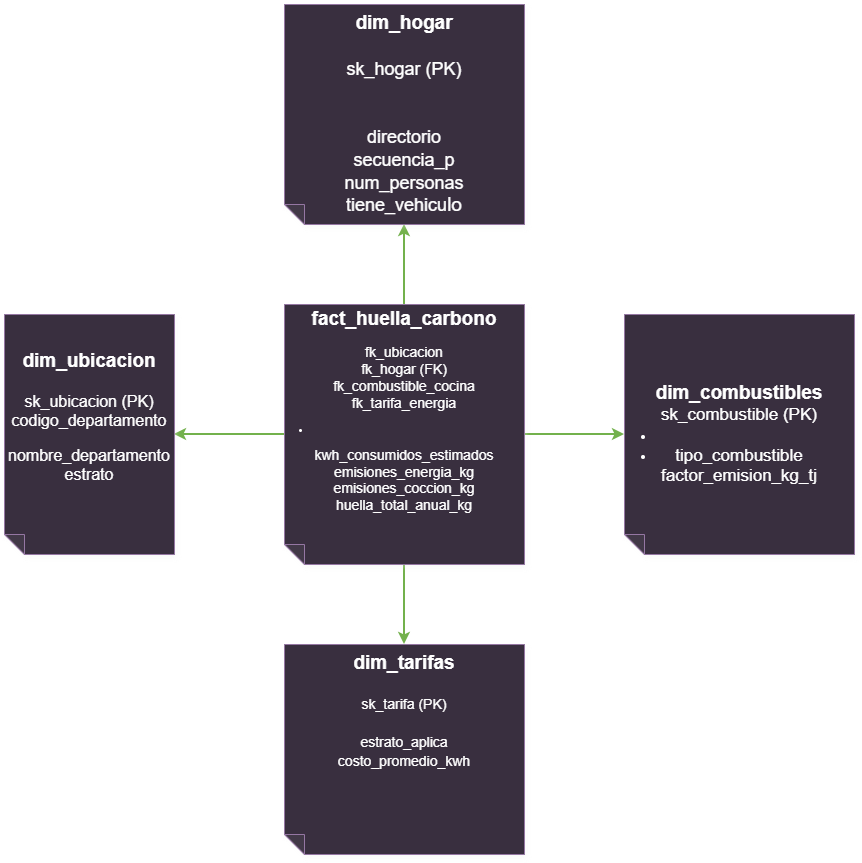

**Resultados principales de la primera fase** (según su README):

| Requisito | Resultado reportado |
|---|---|
| R1 | El consumo y las emisiones eléctricas bajan del estrato 1–2 (≈137–139 kWh/mes) al estrato 6 (≈94 kWh/mes) |
| R2 | Con leña, un hogar emite unas 3 veces más en cocina (≈3.145 kg/año) que con GLP o gas natural (resultado con el factor completo; ver corrección D-04 en la segunda entrega) |
| R3 | Los hogares sin carro mostraron mayor huella (≈1.232 kg) que los que tienen (≈1.030 kg), un resultado contraintuitivo |
| R4 | Vichada, Guainía, Amazonas y Vaupés lideran la huella per cápita (≈620–740 kg) |
| R5 | La huella per cápita baja de ≈1.000 kg (hogares de 1 persona) a ≈243 kg (hogares de 8 personas) |

*Nota:* estos resultados de la primera fase se calcularon con el factor eléctrico 0,097 y con la leña a factor completo. Las correcciones D-04 (leña) y D-06 (factor eléctrico), explicadas en la sección 24, cambian sus valores absolutos; las nuevas cifras de R2 a R5 están en la sección 22.

**Limitaciones de la primera fase que motivaron cambios.**
- R3 no era coherente con los datos: la ECV solo dice si el hogar tiene vehículo, no su consumo (sección 3).
- No incluía un tablero de BI conectado al DW.
- Los supuestos que convierten gasto en consumo y emisiones no estaban documentados con su fuente (sección 24 y [`docs/supuestos_y_trazabilidad.md`](docs/supuestos_y_trazabilidad.md)).
- La ECV no trae información de clima, lo que impedía preguntar si el clima se asocia con el consumo. La segunda entrega lo resuelve con la API del IDEAM (sección 6).

## 3. Estado y cambios de R1–R5

Los requisitos de la primera entrega se revisaron uno por uno. Ninguno se cambió en silencio: cada cambio queda registrado aquí y en la bitácora de [`docs/supuestos_y_trazabilidad.md`](docs/supuestos_y_trazabilidad.md).

| Req. | Estado | Cambio introducido | Justificación | Salida analítica en la segunda entrega |
|---|---|---|---|---|
| R1 | Refinar | Además de por estrato, se puede desagregar por piso térmico uniendo con `dim_clima` | Sirve de puente con R6; no cambia el cálculo de la huella eléctrica | Huella eléctrica media por estrato (y por piso térmico) |
| R2 | Refinar | Ninguno | El requisito sigue siendo válido, pero su resultado cambia: la leña se trata como carbono neutra (CO₂ = 0), como indica la tabla de factores, por lo que ya no emite más que GLP o gas natural (decisión D-04, supuesto S9). Los precios fijos de combustible quedan como limitación documentada | Emisiones de cocina por combustible |
| R3 | **Reemplazar** (queda como **R3′**) | De "peso de los vehículos en las emisiones del hogar" a "comparar la huella por energía y cocina de hogares con y sin vehículo, a igual estrato" | Limitación analítica documentada: la ECV solo informa si hay vehículo (`P1077S15`), no su combustible ni su uso, así que el peso del vehículo no se puede calcular. La primera entrega midió otra cosa sin cambiar el requisito. Detalle y fecha en la bitácora | Huella media por estrato y tenencia de vehículo (asociación; las emisiones del vehículo no están incluidas) |
| R4 | Refinar (precisión) | Se declara que se responde **por departamento** | La primera entrega hablaba de "municipios o departamentos", pero el modelo y la ECV usada solo traen departamento. Es una precisión, no un cambio de fondo | Huella per cápita por departamento |
| R5 | Mantener | Ninguno | Sigue siendo válido y no depende de la API | Huella per cápita por tamaño del hogar |

Los requisitos nuevos R6 y R7, que sí usan la API, están en la sección 4.

## 4. Requisitos integrados R6 y R7

| ID | Requisito | Datos ECV | Datos API | Llave | KPI | Detalle |
|---|---|---|---|---|---|---|
| R6 | ¿Cuántos kWh/mes y kg CO₂ eléctrico más generan los hogares de departamentos cálidos que los de templados o fríos, a igual estrato? | `P5018`, `P5010`, departamento, tarifa | Temperatura media 2025 por departamento | Departamento (DANE) | kWh/mes y kg CO₂/año por piso térmico y estrato; correlación temperatura–kWh | Departamento × estrato |
| R7 | ¿El % de hogares con aire acondicionado o ventilador sube con la temperatura del departamento, y cuánto CO₂ eléctrico extra tienen? | `P1077S11` (aire acondicionado), `P1077S12` (ventilador o abanico), huella eléctrica | Temperatura media 2025 por departamento | Departamento (DANE) | % de hogares con equipo vs temperatura; diferencia de kg CO₂ | Departamento |

## 5. Fuente primaria y fuente API

**Fuente primaria:** ECV 2025 (DANE), 4 capítulos en CSV (`data/raw/ecv/`): Servicios del hogar, Datos de la vivienda,
Características y composición del hogar, Condiciones de vida del hogar y tenencia de bienes (se excluye el capítulo "(programas)").

**API (sección 4.1 del enunciado):**

| Ítem | Documentación |
|---|---|
| Proveedor y propósito | Instituto de Hidrología, Meteorología y Estudios Ambientales (IDEAM). Dataset "Temperatura Ambiente del Aire" en datos.gov.co (id `sbwg-7ju4`): lecturas horarias de estaciones del IDEAM |
| Valor analítico | Aporta clima oficial por departamento, que la ECV no tiene; sin él no se pueden responder R6 ni R7 |
| Endpoint y parámetros | `https://www.datos.gov.co/resource/sbwg-7ju4.json` (SODA). Filtro `codigosensor='0068'` (Temp Aire 2 m, °C). Ventanas de fechas con `$where`, agregación en el servidor con `$select`, `$group`, `$order`, `$limit`, `$offset` |
| Respuesta | JSON (lista de objetos). Se conservan: estación, departamento, municipio, latitud, longitud, suma, conteo, mínimo y máximo por ventana |
| Autenticación | Sin autenticación obligatoria; token de aplicación opcional en la cabecera `X-App-Token` (variable `DATOS_GOV_APP_TOKEN`, nunca en el repositorio) |
| Comportamiento operativo | Páginas de hasta 50 000 filas; reintentos por ventana ante timeout, red, HTTP 429/5xx; error 4xx se trata como falla determinista; sello de tiempo en `api_manifest.json` |
| Reproducibilidad | `docker compose up` + disparar el DAG; otro evaluador usa las mismas fechas (`.env.example`). Licencia CC BY-SA 4.0 (fuente: IDEAM) |

Aviso de la ficha del dataset: el IDEAM no validó los valores publicados y pueden existir errores por fallas de sensor (base de las reglas DQ15 y DQ17).

## 6. Valor analítico aportado por la API

**Qué no puede hacer la ECV sola.** La ECV 2025 describe cuánto paga un hogar de energía, de qué estrato es y en qué departamento vive, pero **no dice qué clima tiene ese departamento**. Sin esa variable no se puede preguntar si el clima se asocia con el consumo eléctrico: R6 y R7 no se pueden ni plantear.

**Qué aporta la API del IDEAM.** La temperatura media del aire de 2025 por departamento (32 de los 33 departamentos de la ECV, ver [`docs/evidence/cobertura_api_ideam_2025.md`](docs/evidence/cobertura_api_ideam_2025.md)). Integrada por el código de departamento (sección 12), permite clasificar cada hogar en piso térmico cálido, templado o frío (cortes en el supuesto S14) y calcular su consumo y emisiones según el clima de su departamento. Cubre al 98,26 % de los hogares (85.339 de 86.848).

**Demostración con el DW (R6).** Estas consultas se ejecutaron sobre el Data Warehouse (`fact_huella_carbono` unida a `dim_clima` y `dim_ubicacion`), solo con hogares con clima emparejado.

*Consumo eléctrico promedio por piso térmico:*

```sql
SELECT c.piso_termico, COUNT(*) AS hogares,
       ROUND(AVG(f.kwh_consumidos_estimados),1) AS kwh_mes_promedio,
       ROUND(AVG(f.emisiones_energia_kg),1) AS kg_co2_energia_promedio
FROM fact_huella_carbono f JOIN dim_clima c ON f.fk_clima = c.sk_clima
WHERE f.clima_emparejado = 1
GROUP BY c.piso_termico ORDER BY kwh_mes_promedio DESC;
```


| Piso térmico | Hogares | kWh/mes promedio | kg CO₂ eléctrico/año promedio |
|---|---|---|---|
| Cálido | 37.694 | 143,6 | 379,1 |
| Templado | 29.661 | 132,0 | 348,4 |
| Frío | 17.984 | 118,0 | 311,6 |

En promedio, un hogar de departamento cálido consume un 21,7 % más electricidad que uno de departamento frío. Esa comparación mezcla estratos, así que se repitió **a igual estrato**, que es lo que pregunta R6:

```sql
SELECT u.estrato, c.piso_termico, COUNT(*) AS hogares,
       ROUND(AVG(f.kwh_consumidos_estimados),1) AS kwh_mes_promedio
FROM fact_huella_carbono f
JOIN dim_clima c ON f.fk_clima = c.sk_clima
JOIN dim_ubicacion u ON f.fk_ubicacion = u.sk_ubicacion
WHERE f.clima_emparejado = 1
GROUP BY u.estrato, c.piso_termico ORDER BY u.estrato, kwh_mes_promedio DESC;
```

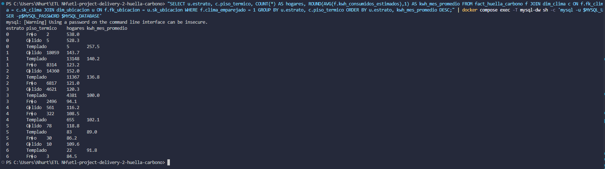

| Estrato | Cálido (hogares · kWh/mes) | Templado | Frío | Cálido vs. frío |
|---|---|---|---|---|
| 1 | 18.059 · 143,7 | 13.148 · 140,2 | 8.314 · 123,2 | +20,5 kWh (+16,6 %) |
| 2 | 14.360 · 152,0 | 11.367 · 136,8 | 6.817 · 121,0 | +31,0 kWh (+25,6 %) |
| 3 | 4.621 · 120,3 | 4.381 · 100,0 | 2.496 · 94,1 | +26,2 kWh (+27,8 %) |
| 4 | 561 · 116,2 | 655 · 102,1 | 322 · 108,5 | +7,7 kWh (+7,1 %) |
| 5 | 78 · 118,8 | 83 · 89,0 | 30 · 86,2 | +32,6 kWh (+37,8 %) |
| 6 | 10 · 109,6 | 22 · 91,8 | 3 · 84,5 | +25,1 kWh (+29,7 %) |

(El estrato 0 agrupa 12 hogares con estrato inválido reclasificado y no se interpreta.)

**Interpretación.**
- **A igual estrato, los hogares de departamentos cálidos consumen más electricidad que los de departamentos fríos, en los seis estratos**, con diferencias de entre 7 % y 38 %. Por lo tanto la diferencia global de 21,7 % no se explica solo porque los departamentos cálidos tengan una mezcla distinta de estratos.
- Los estratos 1 a 3 reúnen el 97,9 % de los hogares con clima, y ahí la diferencia es sólida (17 % a 28 %, con miles de hogares por celda).
- **Cautela con los estratos 4 a 6:** tienen pocos hogares (por ejemplo 3 hogares fríos en el estrato 6 y 10 cálidos), así que sus promedios son inestables. En el estrato 4 el piso frío (108,5) queda por encima del templado (102,1), una excepción al patrón que no se interpreta por el tamaño de la muestra.
- El CO₂ eléctrico anual se calcula como kWh × 12 × 0,220 kg/kWh (supuesto S3, decisión D-06), por lo que la diferencia porcentual de CO₂ es idéntica a la de kWh.

**Límites que se deben declarar.**
- Es una **asociación**, no una causa: los departamentos cálidos y fríos difieren también en otros aspectos (región, tipo de vivienda, ingresos dentro del estrato) que la ECV no controla en este análisis.
- Los kWh **no se miden**: se estiman dividiendo el pago de energía (`P5018`) entre una tarifa por estrato (supuestos S1 y S2). Si las tarifas reales difieren de las supuestas, cambian los niveles, aunque la comparación entre pisos térmicos dentro de un mismo estrato usa la misma tarifa.
- La temperatura es un **promedio departamental** de las estaciones del IDEAM, no la del hogar (supuesto S14). Vaupés queda fuera de R6 y R7 por no tener datos (decisión D-02).

**Demostración con el DW (R7).** La consulta de R7 (`sql/analytical_queries.sql`) une `fact_huella_carbono` con `dim_clima` y `dim_hogar` y calcula, por departamento, el porcentaje de hogares con aire acondicionado (`P1077S11`) y con ventilador o abanico (`P1077S12`), según el [diccionario de datos de la ECV 2025](https://microdatos.dane.gov.co/index.php/catalog/905), junto con la temperatura y el consumo eléctrico. Solo entran hogares con clima emparejado (85.339 hogares, 32 departamentos).


| Piso térmico (IDEAM) | Departamentos | Hogares con aire acondicionado | Hogares con ventilador | kWh/mes | CO₂ eléctrico (kg/año) |
|---|---|---|---|---|---|
| Cálido (>24 °C) | 16 | 9,3 % | 71,8 % | 143,6 | 379,1 |
| Templado (18–24 °C) | 10 | 2,3 % | 31,9 % | 132,0 | 348,4 |
| Frío (<18 °C) | 6 | 2,2 % | 19,6 % | 118,0 | 311,6 |

(Promedios ponderados por número de hogares de cada departamento.)

**Interpretación de R7.**
- **El porcentaje de hogares con equipo sube con la temperatura del departamento.** La correlación de rangos (Spearman) entre temperatura y porcentaje de hogares es 0,82 para ventilador y 0,71 para aire acondicionado. A nivel nacional, 46,9 % de los hogares tiene ventilador y 5,4 % aire acondicionado.
- **El impacto en la huella eléctrica es moderado:** un hogar en un departamento cálido consume ≈22 % más kWh (143,6 contra 118,0) y emite ≈22 % más CO₂ eléctrico (379,1 contra 311,6 kg/año) que uno en un departamento frío. Los dos porcentajes coinciden porque el CO₂ se calcula como kWh × 12 × 0,220 (supuesto S3, decisión D-06).
- **Anomalía de Arauca (decisión D-05, supuesto S16).** Arauca aparece con 10,2 °C y piso "frío", pero 91,3 % de sus hogares tiene ventilador y 11,7 % aire acondicionado, un perfil de clima cálido. La API trae **una sola estación** para Arauca, y su promedio parece no representar a la población del departamento (hipótesis: la ubicación de la estación no se verificó). Los datos no se modificaron. **Sin Arauca la relación es más fuerte** (0,92 para ventilador y 0,81 para aire acondicionado) y el grupo "frío" pasa de 19,6 % a ≈8 % de hogares con ventilador. La conclusión no cambia con ni sin Arauca.
- La misma anomalía afecta al piso "frío" de R6, donde Arauca está incluido.

**Límites de R7.** Es una asociación entre 32 departamentos, no una causa. No se controla por estrato ni por ingresos (el ventilador también depende del nivel económico). La temperatura es un promedio departamental y los kWh son estimados (supuestos S1, S2 y S14).

**Qué se habría perdido sin la API.** La pregunta de R6 no tendría respuesta y el análisis se quedaría en R1–R5 (huella por estrato, combustible, departamento y tamaño del hogar), que describen *cuánto* emite un hogar pero no *si el clima se asocia con ese consumo*. Este bloque se complementa con el KPI y la gráfica del dashboard (sección 21) y con la trazabilidad R6 → KPI (sección 22).

## 7. Arquitectura del sistema

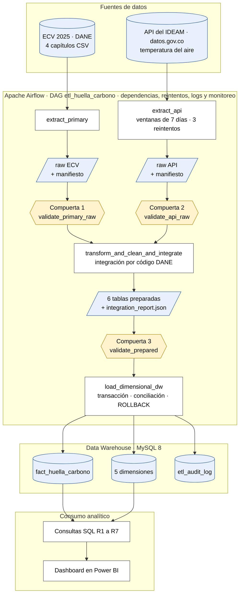

*Cómo se lee:* las formas indican el tipo de elemento. Los cilindros y paralelogramos azules son datos (fuentes, archivos raw y preparados, tablas del DW); los hexágonos amarillos son las tres compuertas de validación; los rectángulos son tareas de Airflow. Cada flecha es una dependencia: una tarea solo corre si la anterior terminó bien.

*Versión detallada con notas, como imagen:* [`docs/architecture.png`](docs/architecture.png) (fuente editable: [`docs/architecture.dot`](docs/architecture.dot), se genera con Graphviz: `dot -Tpng docs/architecture.dot -o docs/architecture.png`).

**Cómo se lee.** El flujo va de arriba hacia abajo: dos fuentes independientes, cada una con su propia rama de extracción, almacenamiento raw y compuerta de validación; las dos ramas se unen en la transformación e integración; el resultado se valida otra vez antes de cargarse al Data Warehouse, y de ahí salen las consultas y el dashboard. Todo el recuadro azul lo orquesta Apache Airflow.

| Componente | Qué es | Dónde vive |
|---|---|---|
| Fuente primaria | ECV 2025 del DANE, 4 capítulos en CSV | `data/raw/ecv/` (no se sube a Git) |
| Fuente API | Temperatura del aire del IDEAM, vía Socrata (dataset `sbwg-7ju4`) | datos.gov.co |
| `extract_primary` | Copia los capítulos tal como llegan, sin limpiar | tarea de Airflow |
| `extract_api` | 53 ventanas de 7 días agregadas en el servidor; cada ventana descargada se guarda y no se vuelve a pedir si la tarea se reintenta | tarea de Airflow |
| Raw ECV y raw API | Copia fiel de cada fuente, con su manifiesto, por corrida | `data/work/<run_id>/raw/` |
| Compuertas 1 y 2 | Validación raw con Great Expectations, una por rama | `validate_primary_raw`, `validate_api_raw` |
| `transform_and_clean_and_integrate` | Limpieza y armonización de la ECV, temperatura por departamento, integración por código DANE y construcción de las tablas del modelo estrella | tarea de Airflow |
| Preparado | 6 tablas CSV y `integration_report.json`, por corrida | `data/work/<run_id>/prepared/` |
| Compuerta 3 | Validación de los datos preparados, una suite por tabla | `validate_prepared` |
| `load_dimensional_dw` | Carga transaccional: borra, inserta dimensiones y hechos, concilia conteos y confirma, o deshace todo si algo falla | tarea de Airflow |
| Data Warehouse | MySQL 8 con esquema en estrella (`fact_huella_carbono` y cinco dimensiones) y `etl_audit_log` | contenedor `mysql-dw`, puerto 3307 |
| Consultas y dashboard | Consultas SQL y KPI de R1–R7, y un dashboard conectado al DW (sección 21) | `sql/` y herramienta de BI |
| Orquestación | Apache Airflow 3.1.8: dependencias, reintentos selectivos, estados, logs e interfaz web; sus metadatos están en PostgreSQL | contenedores de Docker Compose |

**Capas de persistencia, de la más cruda a la más refinada:** (1) las fuentes originales, (2) los archivos raw por corrida, (3) los archivos preparados por corrida, (4) el Data Warehouse. Los archivos raw y preparados son almacenamiento intermedio y de evidencia; **no son el DW analítico**: las consultas y el dashboard leen solo el DW.

**Compuertas de validación.** Hay tres, y una falla Critical en cualquiera hace fallar la tarea y deja sin ejecutar todo lo posterior (la transformación no corre si falla una de las dos compuertas raw, y nada se carga si falla la tercera). Las reglas de severidad `warning` se reportan sin bloquear.

**Qué cubre el diagrama frente a lo que pide la guía:**

| Elemento exigido | Dónde está en el diagrama |
|---|---|
| Fuente primaria y fuente API programática | Recuadro "Fuentes de datos" |
| Extracción o persistencia raw de cada rama | `extract_primary` → RAW ECV; `extract_api` → RAW API |
| Compuertas de validación raw de ambas fuentes | Compuertas 1 y 2 |
| Transformación e integración | `transform_and_clean_and_integrate` |
| Validación de los datos preparados | Compuerta 3 |
| Data Warehouse dimensional en MySQL | Recuadro "Data Warehouse · MySQL 8" |
| Consultas SQL, KPI y dashboard | Recuadro "Consumo analítico" |
| Airflow: dependencias, reintentos, logs y monitoreo | Recuadro "Apache Airflow" (las flechas son las dependencias; `extract_api` muestra sus reintentos) y la tabla de componentes de esta sección |

**Proceso de negocio y grano.** El proceso que se modela es la estimación anual de la huella de carbono residencial de un hogar. El grano de la tabla de hechos es **un registro por hogar encuestado** (`DIRECTORIO` + `SECUENCIA_P`).

## 8. Hallazgos de perfilamiento

Dos notebooks reproducibles en `notebooks/`:

| Notebook | Contenido | Reglas DQ cubiertas |
|---|---|---|
| [`01_perfilamiento_ecv_primaria.ipynb`](notebooks/01_perfilamiento_ecv_primaria.ipynb) | Grano y duplicados, completitud P5018 (~77%), distribución de estrato, contrato columnar de los 4 capítulos, validez P1_DEPARTAMENTO, dominio P1077S15/S11/S12, reformulación R3 | DQ01–DQ11 |
| [`02_perfilamiento_api_ideam.ipynb`](notebooks/02_perfilamiento_api_ideam.ipynb) | Contrato del endpoint SODA, rango físico de temperatura [-15°C, 50°C], cobertura departamental (≥20 dptos), consistencia temporal (2025), coordenadas dentro de Colombia, normalización de nombres de departamentos, clasificación por piso térmico | DQ12–DQ18 |

**Hallazgos clave (con impacto en el pipeline):**
- `P5018` completitud ≈77% (umbral DQ04 ≥70% — conservador con 7pp de margen)
- 212 duplicados en la fase 1 (0.24%) → umbral DQ03 ≥99%; ≤1% = error de carga
- Estratos 7/8: 12 hogares de 88,432 (0.014%) → umbral DQ05 ≥99.9%
- `P1077S15` es puramente binaria {1, 2} → sustenta reformulación de R3
- Nombres de departamentos del IDEAM no estandarizados → tabla `ALIAS_DEPARTAMENTO` en `src/transform.py`
- Fallas de sensor (DQ15): umbral 99.5% basado en aviso oficial de la ficha IDEAM

## 9. Riesgos y reglas de calidad

30 reglas de calidad (DQ01–DQ30) distribuidas en 3 compuertas. Cada umbral tiene base empírica,
contractual, analítica o física documentada. Ningún umbral fue elegido únicamente porque los datos actuales lo cumplen.

## 10. Diseño de Great Expectations y trazabilidad de reglas

| Elemento GX | Implementación |
|---|---|
| Objeto de datos | DataFrame del lote raw (compuertas 1 y 2) o preparado (compuerta 3) |
| Expectation | Una por regla; el ID de la regla va en `meta.rule_id`; severidad en `expectation.severity` |
| Suites (compuerta 1 — raw ECV) | `ecv_servicios_raw_suite` (DQ01–DQ05), `ecv_vivienda_raw_suite` (DQ06–DQ08), `ecv_caracteristicas_raw_suite` (DQ09), `ecv_condiciones_raw_suite` (DQ10–DQ11) |
| Suites (compuerta 2 — raw API) | `api_ideam_raw_suite` (DQ12–DQ18) |
| Suites (compuerta 3 — preparados) | `prepared_fact_huella_suite` (DQ19–DQ25), `prepared_dim_hogar_suite` (DQ26), `prepared_dim_ubicacion_suite` (DQ27), `prepared_dim_clima_suite` (DQ28), `prepared_dim_tarifas_suite` (DQ29), `prepared_dim_combustibles_suite` (DQ30) |
| Validation Definition | Batch del DataFrame + suite (`src/validation.py: run_suite`) — modo `ephemeral` (sin servidor GX) |
| Ejecución controlada | `validate_primary_raw` → `run_ecv_raw_gate()`; `validate_api_raw` → `run_api_raw_gate()`; `validate_prepared` → `run_prepared_gate()` |
| Resultado | `gx/validation_results/<run_id>/<suite>.json`; suites exportadas a `gx/expectations/<suite>.json` |
| Respuesta del pipeline | Critical bloquea (`ValueError`); Warning se registra y continúa; Info solo monitoreo |

## 11. Diseño de validación raw de ambas fuentes

Compuerta 1 (`run_ecv_raw_gate`): valida las 4 tablas de la ECV en paralelo; cualquier Critical bloquea la transformación.  
Compuerta 2 (`run_api_raw_gate`): valida el lote de la API; cualquier Critical bloquea la transformación.  
Ambas compuertas deben superarse antes de que `transform_and_clean_and_integrate` reciba datos.

## 12. Estrategia de transformación y contrato de integración

La estrategia de integración une los microdatos de la ECV con los datos climáticos del IDEAM utilizando el departamento como eje geográfico. El cruce se realiza en memoria mediante Pandas durante la transformación, garantizando la calidad antes de la carga a MySQL.

**Contrato de Integración:**
*   **Llave ECV:** `P1_DEPARTAMENTO` (código DANE numérico), extraído del capítulo "Datos de la vivienda".
*   **Llave API:** `departamento` (texto del IDEAM), el cual se normaliza (minúsculas, sin tildes ni puntuación) y se traduce al código DANE usando el diccionario `data/reference/dane_departamentos.csv` (incluyendo alias como Bogotá y San Andrés).
*   **Cardinalidad:** Muchos a uno (N:1). Muchos hogares se asocian a 1 única fila de clima por departamento.
*   **Alineación temporal:** Ambas fuentes corresponden a ventanas temporales del año 2025.
*   **Tratamiento de no emparejados:** 
    *   Hogares en un departamento sin estaciones del IDEAM: Quedan con `fk_clima` en NULL y bandera `clima_emparejado = 0`. Se conservan para responder R1 a R5, pero se excluyen de R6 y R7.
    *   Departamentos del IDEAM sin código DANE: Se descartan y se reportan en la bitácora.
*   **Tratamiento de duplicados:** Se agrupan múltiples estaciones por departamento calculando un promedio ponderado por el número de lecturas. Filas con temperaturas fuera del rango físico plausible (ej. < -15°C o > 50°C) se excluyen.
*   **Supuestos de negocio (S14):** Los cortes de piso térmico se establecieron en: Cálido (>24°C), Templado (18°C - 24°C) y Frío (<18°C). El promedio departamental resume el clima de las estaciones, asumiendo que representa la región.

*   **Cobertura real de la API y decisión sobre Vaupés (D-02):** la consulta al IDEAM en tres ventanas de 2025 dio **32 de 33 departamentos** ([evidencia](docs/evidence/cobertura_api_ideam_2025.md)). **Vaupés (97) no tiene estaciones con datos**, así que sus 1.509 hogares (≈1,7 %) quedan con `fk_clima` NULL y `clima_emparejado = 0`: se conservan en R1–R5 y se excluyen de R6 y R7. **No se le asigna 0 °C ni la temperatura de otro departamento**, porque eso sería un dato inventado: Vaupés es cálido y un 0 lo clasificaría como "Frío", sesgando R6 y R7. Razonamiento completo en [`docs/supuestos_y_trazabilidad.md`](docs/supuestos_y_trazabilidad.md) (D-02).

**Evidencia de transformación e integración (antes y después).** El pipeline genera automáticamente un informe con los conteos de cada corrida. Estos son los de la corrida exitosa `manual__2026-10-21T22_11_02.143248_00_00` (archivo completo: [`docs/evidence/integration_report.json`](docs/evidence/integration_report.json)):

*Limpieza de la ECV (fuente primaria).*

| Paso | Hogares / valores |
|---|---|
| Hogares de entrada (4 capítulos unidos) | 87.060 |
| Duplicados eliminados (llave `DIRECTORIO` + `SECUENCIA_P`) | 212 |
| `P5018` (pago de energía) nulos imputados con la mediana del estrato | 19.969 |
| `P5018` atípicos truncados al percentil 99 | 855 |
| `P5018` en cero imputados (estrato distinto de 1) | 123 |
| Estratos inválidos reclasificados a 0 | 12 |
| **Hogares de salida** | **86.848** (= 87.060 − 212) |

*Integración con la API del IDEAM (llave: código de departamento DANE).*

| Indicador | Valor |
|---|---|
| Filas de la API (estación × ventana de 7 días) | 14.963 |
| Filas sin `suma` o `n`, o con temperatura fuera de −15…50 °C, excluidas | 0 |
| Nombres de departamento del IDEAM sin código DANE (descartados) | 0 |
| Departamentos en la ECV | 33 |
| Departamentos con clima (filas de `dim_clima`) | 32 |
| Departamento de la ECV sin clima | 97 (Vaupés) |
| **Hogares con clima emparejado** | **85.339 (98,26 %)** |
| **Hogares sin clima** (`fk_clima` NULL, `clima_emparejado = 0`) | **1.509 (1,74 %)** |

*Interpretación.*
- Los 86.848 hogares coinciden con los de `dim_hogar` y con las filas de `fact_huella_carbono` en el DW (sección 18): ningún hogar se perdió en la integración.
- **Hogares no emparejados:** solo los de Vaupés. Se conservan para R1–R5 y se excluyen de R6 y R7, según la decisión D-02 de la sección anterior.
- **Coincidencias repetidas o ambiguas:** no pueden ocurrir. `dim_clima` tiene una sola fila por departamento (32 filas para 32 departamentos), así que cada hogar cruza como máximo con una fila de clima. Las estaciones múltiples de un departamento se resumen antes del cruce con un promedio ponderado por número de lecturas.
- **Calidad de la API:** en esta corrida ninguna fila fue excluida por faltar datos o por salir del rango físico, y todos los nombres de departamento se tradujeron a código DANE.
- **Límite de la integración:** la temperatura es un promedio departamental. Resume el clima de las estaciones del departamento y no distingue entre municipios de distinta altitud; por eso R6 y R7 se interpretan como asociaciones a nivel de departamento (supuesto S14).

## 13. Modelo dimensional refinado y justificación de cambios

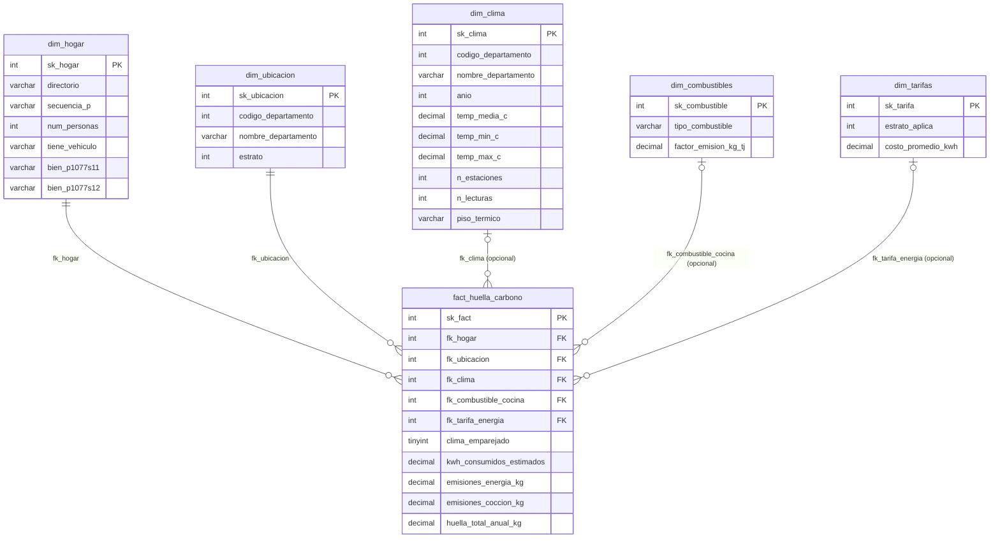

*Cómo se lee:* cada recuadro es una tabla con sus columnas; `PK` es la llave primaria y `FK` la llave foránea. Las líneas unen la tabla de hechos con cada dimensión (un hogar de la tabla de hechos apunta a una fila de cada dimensión). Las llaves del clima, el combustible y la tarifa pueden ser nulas: no todo hogar tiene clima emparejado, combustible de cocina ni tarifa.

*Versión como imagen:* [`docs/star_schema.png`](docs/star_schema.png) (fuente: [`docs/star_schema.dot`](docs/star_schema.dot)). El modelo de la primera entrega está en [`docs/evidence/star_schema.png`](docs/evidence/star_schema.png).

**Tablas del modelo:**

| Tabla | Tipo | Grano (una fila es...) | Llave | Filas | Fuente |
|---|---|---|---|---|---|
| `fact_huella_carbono` | Hechos | un hogar encuestado | `sk_fact` | 86.848 | ECV 2025, calculada en la transformación |
| `dim_hogar` | Dimensión | un hogar | `sk_hogar` | 86.848 | ECV (características y condiciones) |
| `dim_ubicacion` | Dimensión | un departamento y un estrato | `sk_ubicacion` | 193 | ECV (vivienda y servicios) |
| `dim_clima` | Dimensión (**nueva**) | un departamento | `sk_clima` | 32 | **API del IDEAM** |
| `dim_combustibles` | Dimensión | un combustible de cocina | `sk_combustible` | 3 | `data/reference/dim_combustibles.csv` |
| `dim_tarifas` | Dimensión | un estrato | `sk_tarifa` | 6 | `data/reference/dim_tarifas.csv` |
| `etl_audit_log` | Auditoría (fuera del modelo estrella) | una tabla cargada en una corrida | — | 6 por corrida | pipeline |

**Grano del modelo:** 
Una fila en la tabla de hechos (`fact_huella_carbono`) representa la estimación del consumo eléctrico y la huella de carbono anual de **un (1) hogar encuestado** en la ECV 2025.

**Bitácora de cambios frente a la Fase 1.** Para responder R6 y R7, el esquema estrella de la primera entrega se refinó así (comparación hecha contra [`docs/fase1_referencia/create_dw.sql`](docs/fase1_referencia/create_dw.sql)):

| Cambio | Dónde | Por qué |
|---|---|---|
| **Nueva dimensión `dim_clima`** (temperatura media, mínima y máxima, estaciones, lecturas y `piso_termico`) | Modelo | Es el lugar donde entra la API del IDEAM: sin ella no hay clima por departamento y R6 y R7 no tienen respuesta |
| Nueva llave `fk_clima` (puede ser nula) | `fact_huella_carbono` | Une cada hogar con el clima de su departamento. Nula para Vaupés, que no tiene datos (D-02) |
| Nueva columna `clima_emparejado` (0 o 1) | `fact_huella_carbono` | Permite excluir de R6 y R7 a los hogares sin clima sin perderlos para R1 a R5 |
| Nuevas columnas `bien_p1077s11` (aire acondicionado) y `bien_p1077s12` (ventilador) | `dim_hogar` | Datos de R7: porcentaje de hogares con equipo de climatización |
| Medidas en `DECIMAL` en vez de `REAL` | `fact_huella_carbono` y dimensiones | Evita errores de redondeo de punto flotante al sumar y promediar emisiones (decisión de diseño) |
| Restricciones `ON DELETE RESTRICT`, valores por defecto e índices | Todas | Protegen la integridad referencial y aceleran las consultas por estrato, clima y combustible |
| Nueva tabla `etl_audit_log` | Fuera del modelo estrella | Registra cada carga (tabla, filas, estado), como respaldo de la conciliación y del `ROLLBACK` (sección 20) |

**Validación de Requisitos (R1 - R7):**
El modelo actualizado mantiene plena compatibilidad con los requerimientos originales, permitiendo cruzar las emisiones con el estrato (`dim_ubicacion`), combustible (`dim_combustibles`) y características del hogar (`dim_hogar`). Además, el nuevo modelo valida con éxito la expansión analítica al permitir cruzar el consumo eléctrico y las emisiones contra la nueva `dim_clima` para responder a las preguntas R6 y R7.

## 14. Validación de datos preparados

Compuerta 3 implementada en `run_prepared_gate()` (`src/validation.py`). Valida 6 tablas:

| Tabla | Suite | Reglas | Checks clave |
|---|---|---|---|
| `fact_huella_carbono` | `prepared_fact_huella_suite` | DQ19–DQ25 | Grano único, FKs no nulas, emparejamiento ≥50%, emisiones ≥0, consistencia total |
| `dim_hogar` | `prepared_dim_hogar_suite` | DQ26 | `sk_hogar` único, `num_personas` ≥1, tenencia en `{Sí, No}` |
| `dim_ubicacion` | `prepared_dim_ubicacion_suite` | DQ27 | Surrogate único, estrato en [0,6], código departamento no nulo |
| `dim_clima` | `prepared_dim_clima_suite` | DQ28 | 1 fila/departamento, temperatura [-15,50]°C, consistencia min≤media≤max, piso térmico en dominio, ≥20 dptos |
| `dim_tarifas` | `prepared_dim_tarifas_suite` | DQ29 | Surrogate único, estratos 1–6, costo > 0 |
| `dim_combustibles` | `prepared_dim_combustibles_suite` | DQ30 | Surrogate único, factor emisión > 0 |

## 15. Implementación y carga del Data Warehouse

La base de datos analítica es **MySQL 8** (contenedor `mysql-dw`, expuesto en el puerto 3307 del equipo). El Data Warehouse es independiente de la base de metadatos de Airflow (PostgreSQL) y de los archivos raw o preparados, que son solo almacenamiento intermedio.

*   **Estructuras dimensionales:** [`sql/dw_schema.sql`](sql/dw_schema.sql) crea con `CREATE TABLE IF NOT EXISTS` cinco dimensiones (`dim_hogar`, `dim_ubicacion`, `dim_clima`, `dim_combustibles`, `dim_tarifas`), la tabla de hechos `fact_huella_carbono` y la tabla de auditoría `etl_audit_log`. `load_dw` aplica el esquema en cada carga, así que el DW se crea solo al primer uso.
*   **Grano de la tabla de hechos:** un registro por hogar encuestado (`DIRECTORIO` + `SECUENCIA_P`).
*   **Llaves y relaciones:** cada tabla tiene llave primaria surrogate (`sk_*`). La tabla de hechos tiene cinco llaves foráneas (`fk_hogar`, `fk_ubicacion`, `fk_clima`, `fk_combustible_cocina`, `fk_tarifa_energia`) con `ON DELETE RESTRICT`, así que MySQL rechaza cualquier hecho que apunte a una dimensión inexistente. `fk_clima`, `fk_combustible_cocina` y `fk_tarifa_energia` admiten NULL; en `fk_clima` es la forma de representar a los hogares sin clima (Vaupés), junto con la bandera `clima_emparejado = 0`.
*   **Solo datos aceptados:** `load_dimensional_dw` depende de `validate_prepared` en el DAG. Si esa compuerta tiene un Critical, la carga ni siquiera empieza (ver sección 14).
*   **Orden de carga:** primero se borran los hechos y luego las dimensiones; después se insertan las dimensiones (padres) y por último los hechos (hija), siempre dentro de una sola transacción (sección 20). Los `INSERT` se hacen en bloques de 5.000 filas.
*   **Conciliación de conteos:** antes de confirmar, la carga cuenta las filas de cada tabla en MySQL y las compara con las filas de los archivos preparados. Si alguna tabla no coincide lanza `LoadReconciliationError` y se hace `ROLLBACK`. Cada carga exitosa deja una fila por tabla en `etl_audit_log`.

**Evidencia de carga.** Conteo directo en MySQL después de la corrida exitosa (Prueba A, sección 18):

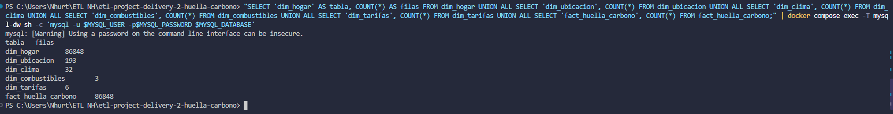

| Tabla | Filas en el DW |
|---|---|
| `dim_hogar` | 86.848 |
| `dim_ubicacion` | 193 |
| `dim_clima` | 32 |
| `dim_combustibles` | 3 |
| `dim_tarifas` | 6 |
| `fact_huella_carbono` | 86.848 |

**Controles de integridad y conciliación.** Consultas de solo lectura sobre el DW cargado:

```sql
SELECT clima_emparejado, COUNT(*) AS hechos FROM fact_huella_carbono GROUP BY clima_emparejado;
SELECT COUNT(*) AS filas_hechos, COUNT(DISTINCT fk_hogar) AS hogares_distintos FROM fact_huella_carbono;
SELECT COUNT(*) AS hechos_sin_hogar FROM fact_huella_carbono f
  LEFT JOIN dim_hogar h ON f.fk_hogar = h.sk_hogar WHERE h.sk_hogar IS NULL;
SELECT COUNT(*) AS hechos_con_clima_inexistente FROM fact_huella_carbono f
  LEFT JOIN dim_clima c ON f.fk_clima = c.sk_clima WHERE f.fk_clima IS NOT NULL AND c.sk_clima IS NULL;
```

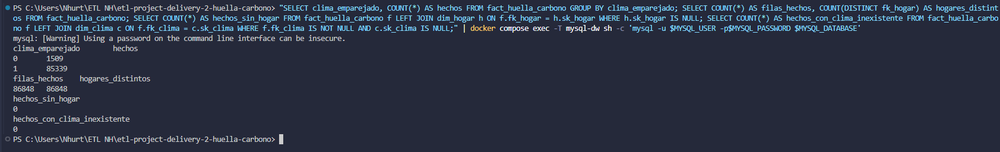

| Control | Resultado | Qué demuestra |
|---|---|---|
| Hechos con `clima_emparejado = 1` | 85.339 | Coincide con `hogares_con_clima` del reporte de integración (sección 12) |
| Hechos con `clima_emparejado = 0` | 1.509 | Coincide con `hogares_sin_clima`: los hogares de Vaupés, conservados con `fk_clima` NULL |
| Filas de hechos / hogares distintos | 86.848 / 86.848 | Se cumple el grano: una fila por hogar, sin repetidos |
| Hechos sin hogar en `dim_hogar` | 0 | No hay hechos huérfanos |
| Hechos con clima inexistente en `dim_clima` | 0 | Integridad referencial de la dimensión de clima |

**Interpretación.** Los 86.848 hogares aceptados por la compuerta de datos preparados llegaron completos al DW: ninguno se perdió ni se duplicó. La suma de hechos con y sin clima (85.339 + 1.509) es igual al total, y esos dos números coinciden con el informe que genera la transformación, así que la conciliación cuadra de extremo a extremo (ECV → transformación → DW). Los hogares sin clima no son un error: están contados, marcados y excluidos de R6 y R7 por la decisión D-02.

## 16. Diseño del DAG de Airflow e interfaces de las tareas

**Lo que muestra Airflow.** Vista de grafo del DAG `etl_huella_carbono` en la interfaz web de Airflow 3.1.8:

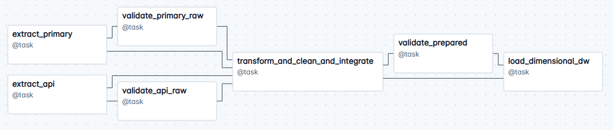

*Qué demuestra:* el DAG tiene **7 tareas** en dos ramas independientes que se unen. A la izquierda, `extract_primary` con `validate_primary_raw` y `extract_api` con `validate_api_raw`; en el centro, `transform_and_clean_and_integrate`; a la derecha, `validate_prepared` y `load_dimensional_dw`.

*Cómo leer las flechas.* Hay dos tipos de dependencia, y ambas se ven en el grafo:
- **Dependencias de datos.** En el código, cada tarea recibe como argumento lo que devolvió otra. `validate_primary_raw` recibe la salida de `extract_primary`, `validate_api_raw` la de `extract_api`, y la transformación recibe las dos extracciones. Por eso salen líneas directas desde `extract_primary` y `extract_api` hacia la transformación, y otra desde la transformación hacia `load_dimensional_dw`, que recibe las tablas preparadas.
- **Dependencias de compuerta, escritas a propósito.** `[validate_primary_raw, validate_api_raw] >> transform_and_clean_and_integrate` y `validate_prepared >> load_dimensional_dw`. Hacen que la transformación solo corra si **ambas** compuertas raw aprobaron, y que nada se cargue si la compuerta de datos preparados falla, aunque la carga ya tenga sus datos listos.

**Configuración del DAG** (en [`dags/etl_huella_carbono_dag.py`](dags/etl_huella_carbono_dag.py)):

| Parámetro | Valor | Por qué |
|---|---|---|
| `schedule` | ninguno (ejecución manual) | Cada corrida se dispara y se inspecciona a mano |
| `max_active_runs` | 1 | Dos cargas simultáneas al DW no son seguras |
| `catchup` | falso | No se recuperan fechas pasadas |
| `execution_timeout` | 20 minutos por tarea (la API tiene 60) | Una tarea colgada no bloquea el pipeline |
| Parámetro `ecv_source` | `raw` (datos reales) o `test` (lote dañado de la Prueba B) | Permite la falla controlada sin tocar el código |
| Reintentos | Ninguno en validaciones, extracción local y transformación; 3 en `extract_api` y 3 en la carga | Solo se reintenta lo transitorio (sección 17) |

**Interfaces de las tareas:**

| Tarea | Entrada | Salida | Identidad del lote | Señal de falla | Re-ejecución |
|---|---|---|---|---|---|
| extract_primary | parámetro `ecv_source` | rutas raw + `ecv_manifest.json` | `run_id` | excepción (archivo o columna faltante) | rescribe `data/work/<run_id>/` |
| extract_api | fechas de `.env` | `api_ideam_raw.csv` + `api_manifest.json` | `run_id` | `APITransientError` / `APIContractError` | reanuda: reutiliza las ventanas ya descargadas |
| validate_*_raw | ruta del lote raw | resumen de GX + JSON | `run_id` | `ValueError` si hay Critical | idempotente |
| transform_and_clean_and_integrate | rutas raw | rutas de 6 tablas preparadas + reporte de integración | `run_id` | excepción | reescribe `data/work/<run_id>/prepared/` |
| validate_prepared | rutas de las 6 tablas preparadas | resumen de GX por tabla | `run_id` | `ValueError` si hay Critical | idempotente |
| load_dimensional_dw | rutas preparadas | conciliación de conteos + filas en `etl_audit_log` | `run_id` | `LoadReconciliationError` / error de BD | transaccional: DELETE+INSERT+COMMIT; ROLLBACK si falla (prueba C) |

Las tareas intercambian rutas y metadatos compactos; nunca DataFrames completos por XCom.

## 17. Políticas de falla y reintentos

**Principio.** Un reintento solo tiene sentido si la falla **puede desaparecer sola** al repetir la tarea sin cambiar datos ni código (red caída, servicio ocupado). Si la falla es **determinista** (un dato inválido, una regla Critical, una tabla inexistente), repetir solo gasta tiempo y reproduce el mismo error; en ese caso la tarea falla de inmediato y se deja la causa visible en el log.

**Configuración en el DAG** (`dags/etl_huella_carbono_dag.py`):

| Tarea | Reintentos | Espera entre reintentos | Tope de espera | Tiempo máximo |
|---|---|---|---|---|
| `extract_api` | 3 | 1 min, exponencial (1 → 2 → 4 min) | 5 min | 60 min |
| `load_dimensional_dw` | 3 | 30 s, exponencial (30 → 60 → 120 s) | 3 min | — |
| `extract_primary`, `validate_primary_raw`, `validate_api_raw`, `transform_and_clean_and_integrate`, `validate_prepared` | 0 | — | — | — |

**Condiciones de falla y respuesta:**

| Condición | Tipo | Respuesta | Reintento | Evidencia o justificación |
|---|---|---|---|---|
| API caída, timeout, HTTP 429 o 5xx | Transitoria | Primero 3 intentos locales por ventana (esperas de 5 y 10 s); si persiste, falla la tarea y Airflow la reintenta | Sí | Justificación abajo. No se forzó una falla transitoria en Docker. |
| API responde 4xx o con forma inesperada | Determinista | `APIContractError` → `AirflowFailException` | No | Repetir la misma petición reproduce el error |
| MySQL no disponible, conexión cortada, deadlock, timeout de bloqueo | Transitoria | La excepción se relanza y Airflow reintenta | Sí | Justificación abajo. No se forzó en Docker. |
| Error de datos, de esquema o de restricción en la carga | Determinista | `AirflowFailException`; `ROLLBACK` | No | **Prueba C-2** (sección 20): error 1644, falló en el intento 1 y no se reintentó |
| Conteos del DW que no concilian con lo preparado | Determinista | `LoadReconciliationError`; `ROLLBACK` | No | Mismo lote daría el mismo resultado |
| Falta un archivo o una columna requerida de la ECV | Determinista | Falla de `extract_primary` | No | Reintentar no crea el archivo ni la columna |
| Critical de Great Expectations (validación raw o preparada) | Determinista | Falla la compuerta; lo posterior no se ejecuta | No | **Prueba B** (sección 19): `validate_primary_raw` falló en el intento 1 y las tres tareas siguientes quedaron sin ejecutar |

**Por qué estos valores.**
- **API (3 reintentos, 1 → 2 → 4 min, tope 5 min).** `extract_api` hace unas 53 consultas seguidas (año 2025 en ventanas de 7 días) a un servicio público. En nuestras corridas la tarea tardó 1 min 28 s, 4 min 45 s y 4 min 53 s: el tiempo de respuesta varía bastante entre una corrida y otra. Por eso hay dos capas: los intentos por ventana (5 y 10 s) absorben fallos cortos sin repetir la tarea, y los reintentos de la tarea esperan un total de 7 minutos para cubrir una indisponibilidad más larga. Cada ventana descargada se guarda como JSON, de modo que **un reintento continúa desde la ventana que falló, no desde el principio**: reintentar es barato. El tiempo máximo de 60 min es unas 12 veces lo observado, para que una API lenta no se confunda con una caída.
- **Base de datos (3 reintentos, 30 → 60 → 120 s, tope 3 min).** La primera espera de 30 s coincide con el periodo de arranque que damos a MySQL en `docker-compose.yaml` (`start_period: 30s`), y el total de 3,5 min cubre un reinicio del contenedor. Reintentar la carga es seguro porque es transaccional y repetible: una carga repetida sobre el mismo lote no duplica (Prueba C) y una carga interrumpida se deshace por completo (Prueba C-2).
- **Sin reintentos en el resto.** Extracción local, validaciones y transformación operan sobre archivos que no cambian entre intentos, así que una segunda ejecución daría el mismo resultado.

**Alcance de la evidencia.** Las dos decisiones de **no reintentar** están demostradas en Docker (Pruebas B y C-2). Los reintentos ante fallas **transitorias** están configurados y justificados, pero no se forzó en Docker una caída de la API ni de MySQL, por lo que no se presentan como evidencia ejecutada.

## 18. Evidencia de la corrida exitosa (Prueba A)

**Qué se ejecutó.** El DAG `etl_huella_carbono` en Docker (Airflow 3.1.8, MySQL 8), disparado a mano por el usuario `admin` con `ecv_source = raw` (ECV 2025 real) y la API del IDEAM para todo 2025 (ventanas de 7 días). Corrida `manual__2026-10-21T04:07:03.156493+00:00`.

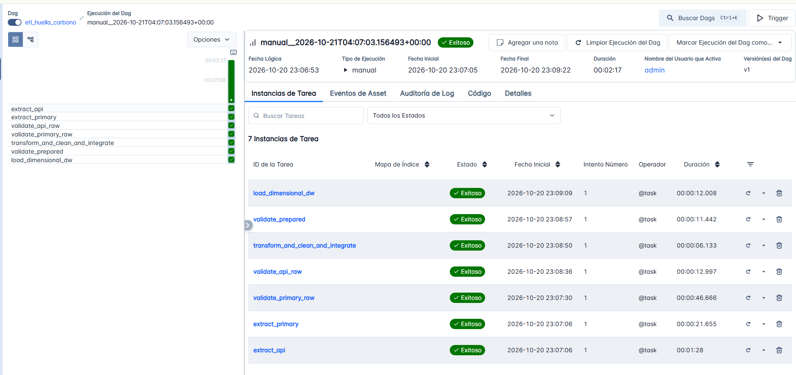

| Tarea | Estado | Intento | Duración |
|---|---|---|---|
| `extract_primary` | Éxito | 1 | 21,7 s |
| `extract_api` | Éxito | 1 | 1 min 28 s |
| `validate_primary_raw` | Éxito | 1 | 46,7 s |
| `validate_api_raw` | Éxito | 1 | 13,0 s |
| `transform_and_clean_and_integrate` | Éxito | 1 | 6,1 s |
| `validate_prepared` | Éxito | 1 | 11,4 s |
| `load_dimensional_dw` | Éxito | 1 | 12,0 s |

La corrida completa duró 2 min 17 s (inicio 23:07:05, fin 23:09:22, hora de Colombia).

**Conciliación en el Data Warehouse.** Conteo hecho directamente en MySQL después de la carga:


| Tabla | Filas |
|---|---|
| `dim_hogar` | 86.848 |
| `dim_ubicacion` | 193 |
| `dim_clima` | 32 |
| `dim_combustibles` | 3 |
| `dim_tarifas` | 6 |
| `fact_huella_carbono` | 86.848 |

**Interpretación.**
- Las 7 tareas pasaron al **primer intento**: no hizo falta ningún reintento, y las dos compuertas raw y la de datos preparados no encontraron fallas Critical.
- `fact_huella_carbono` tiene exactamente las mismas filas que `dim_hogar` (86.848): una fila de hechos por hogar, que es el grano declarado, y coincide con los 86.848 hogares finales de la Primera Entrega.
- `dim_clima` tiene 32 filas: los 32 departamentos con dato de temperatura del IDEAM. Vaupés no tiene estaciones con dato; su tratamiento está documentado en la decisión D-02 de [`docs/supuestos_y_trazabilidad.md`](docs/supuestos_y_trazabilidad.md) y en [`docs/evidence/cobertura_api_ideam_2025.md`](docs/evidence/cobertura_api_ideam_2025.md).
- La carga quedó registrada en `etl_audit_log` (6 filas, una por tabla, estado `SUCCESS`).

**Corrida final después de las correcciones D-04 y D-06.** Después de corregir tres puntos (leña como carbono neutra, factor eléctrico de la UPME y significado de `P1077S11` y `P1077S12`) se volvió a ejecutar el DAG completo con `ecv_source = raw`. Corrida `manual__2026-10-22T00:56:02.910409+00:00`: las 7 tareas terminaron en **Éxito al primer intento** en 2 min 1 s.

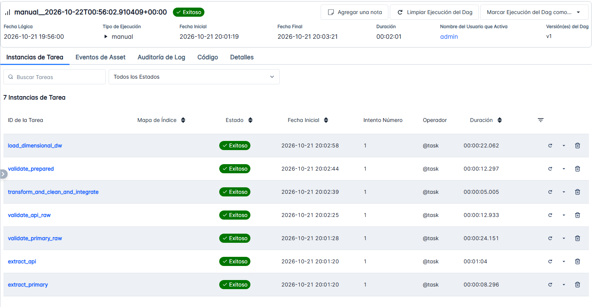

Los conteos de carga no cambiaron (mismos 86.848 hogares), porque las correcciones modifican valores, no filas. Lo que sí cambió son las medidas de emisiones. Consulta directa al DW después de esta corrida:

| Medida | Valor |
|---|---|
| Huella media por hogar | 905 kg CO₂/año |
| Emisión eléctrica media | 351 kg CO₂/año |
| Cocina con GLP (31.489 hogares) | 994 kg · huella total 1.323 kg |
| Cocina con gas natural (38.400 hogares) | 436 kg · huella total 849 kg |
| Cocina con leña (13.943 hogares) | 0 kg (carbono neutra) · huella total 245 kg |
| Sin combustible de cocina (3.016 hogares) | 0 kg · huella total 293 kg |

Por eso las capturas de las secciones 6 y 22 usan los valores de esta corrida, y los de la primera entrega no son comparables en valor absoluto (sección 24).

## 19. Evidencia de la falla controlada (Prueba B)

**Cómo se provoca.** `src/make_bad_data.py` no toca los archivos originales: crea una copia de `Datos de la vivienda.csv` en `data/test/` con **una sola** violación determinista. En la fila 0, `P1_DEPARTAMENTO` pasa de `13` a `999`, un código que no existe en DIVIPOLA. Rompe la regla **DQ08 (Critical)**, porque ese código es la llave de integración con la API.

```
docker compose exec airflow-scheduler python /opt/airflow/src/make_bad_data.py
```

Después se dispara el DAG con `ecv_source = test`.

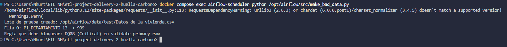

**Resultado en Airflow.** Corrida `manual__2026-10-21T21:18:07.523926+00:00`, estado final **Fallido**.

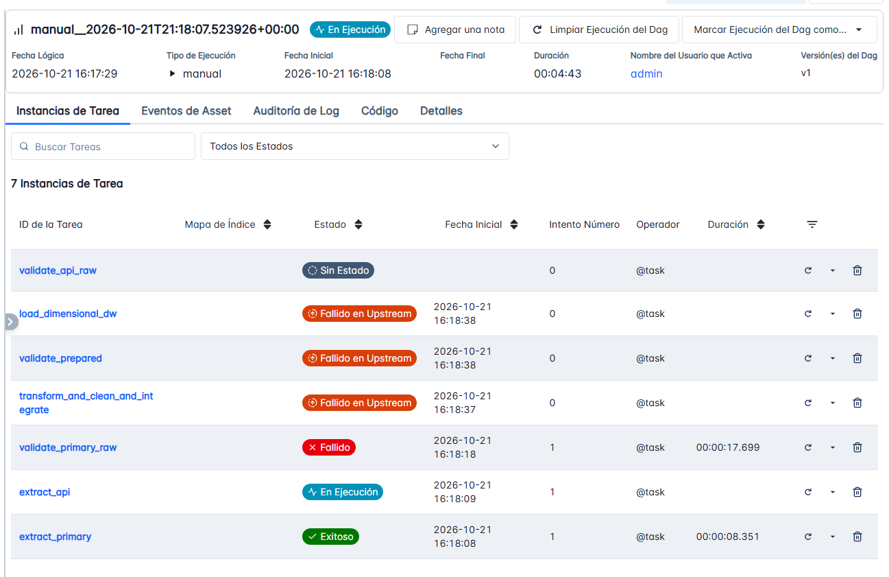

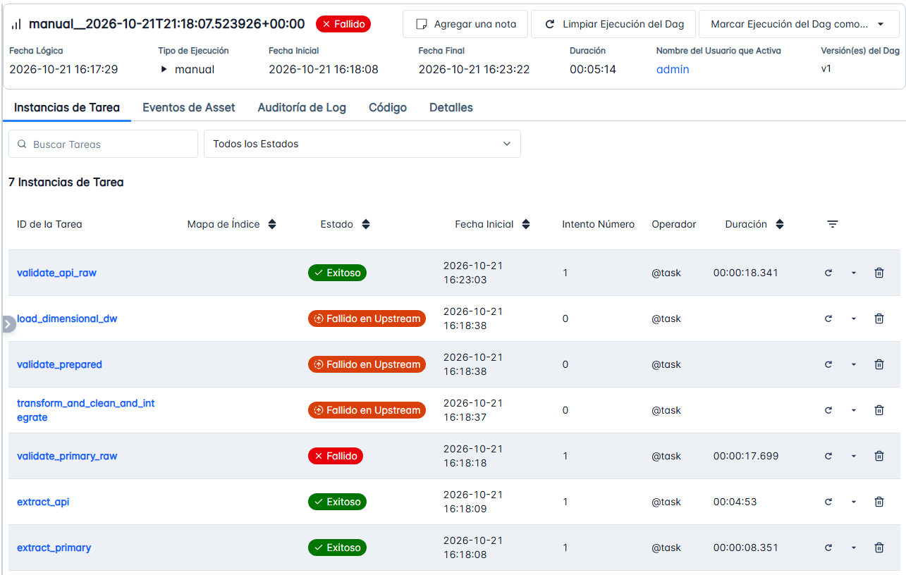

| Tarea | Estado | Intento |
|---|---|---|
| `extract_primary` | Éxito | 1 |
| `extract_api` | Éxito (4 min 53 s) | 1 |
| `validate_api_raw` | Éxito | 1 |
| `validate_primary_raw` | **Fallido** | 1 |
| `transform_and_clean_and_integrate` | Fallido en Upstream (no se ejecutó) | 0 |
| `validate_prepared` | Fallido en Upstream (no se ejecutó) | 0 |
| `load_dimensional_dw` | Fallido en Upstream (no se ejecutó) | 0 |

**Log de la falla.** Las suites de servicios, condiciones y características pasaron (“Compuerta superada según la política”). Solo falló `ecv_vivienda_raw_suite`, por la regla DQ08:

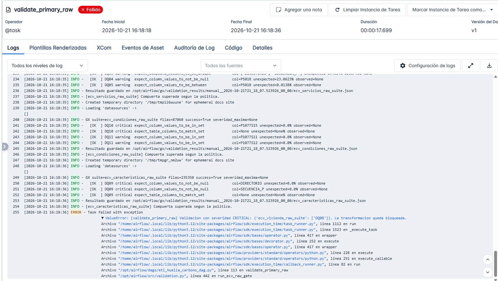

```
ValueError: [validate_primary_raw] Validacion con severidad CRITICA:
{'ecv_vivienda_raw_suite': ['DQ08']}. La transformacion queda bloqueada.
```

**El Data Warehouse queda intacto.** Conteo en MySQL después de la corrida fallida: los mismos valores de la Prueba A, y `etl_audit_log` conserva solo las cargas buenas anteriores (ninguna fila nueva de esta corrida).

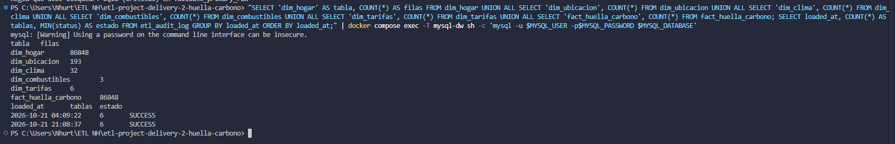

**Interpretación.**
- La falla es **determinista**: repetir la validación con el mismo archivo daría el mismo resultado. Por eso `validate_primary_raw` falló en el **intento 1** y Airflow no reintentó, como define la política de la sección 17 (Critical de Great Expectations: sin reintento).
- Las tres tareas posteriores quedaron en “Fallido en Upstream” con 0 intentos: Airflow ni siquiera las empezó. Eso demuestra que la compuerta bloquea la transformación y la carga.
- La rama de la API siguió su curso y terminó bien (`extract_api` y `validate_api_raw` en Éxito). Las dos ramas son independientes; la transformación solo corre cuando **ambas** cumplen la política.
- Las reglas de severidad `warning` (por ejemplo DQ04 y DQ05, en el mismo log) se reportan pero no bloquean; solo una falla Critical detiene el flujo.

Para volver a los datos reales basta ejecutar con `ecv_source = raw`. `data/test/` está en `.gitignore`.

## 20. Repetibilidad y estrategia de re-ejecución segura (Prueba C)

**Estrategia (`src/load.py`).**
1. **Esquema fuera de la transacción.** `CREATE TABLE IF NOT EXISTS` se aplica antes, en su propia conexión, porque en MySQL el DDL confirma de forma implícita y no puede ser parte de una transacción.
2. **Una sola transacción para los datos.** La conexión se abre con `autocommit=False`. Dentro de ella: `DELETE` (primero los hechos, luego las dimensiones, por las llaves foráneas), `INSERT` (primero las dimensiones, luego los hechos), conciliación de conteos contra los archivos preparados, registro en `etl_audit_log` y `COMMIT`.
3. **Sin `TRUNCATE`.** Es DDL y confirmaría el borrado antes de saber si la inserción sale bien.
4. **Rollback ante cualquier falla.** Si algo falla, incluida una conciliación que no cuadra, se hace `ROLLBACK` y el DW queda como estaba antes del intento. El intento fallido se deja registrado en `etl_audit_log` con estado `FAILED`, en una conexión aparte.
5. **Llaves deterministas.** Las llaves surrogate vienen de los archivos preparados, así que cargar el mismo lote dos veces deja el mismo contenido.

**Qué se ejecutó.** En la misma corrida de la Prueba A se limpió solo la tarea `load_dimensional_dw` (botón “Limpiar tarea”, sin tareas anteriores ni posteriores), lo que la repite sobre el mismo lote de datos preparados.

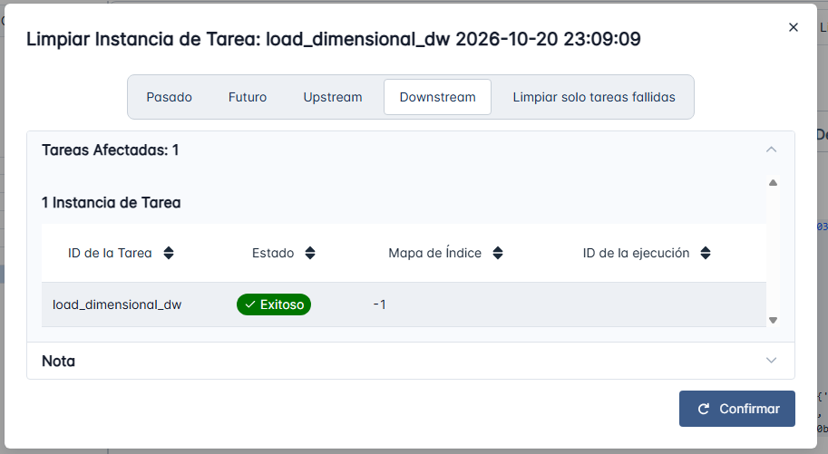

La tarea terminó en Éxito en el **intento 2** (29 s). El log muestra que volvió a insertar exactamente las mismas cantidades y cerró con “Carga exitosa del lote… Conciliación”:

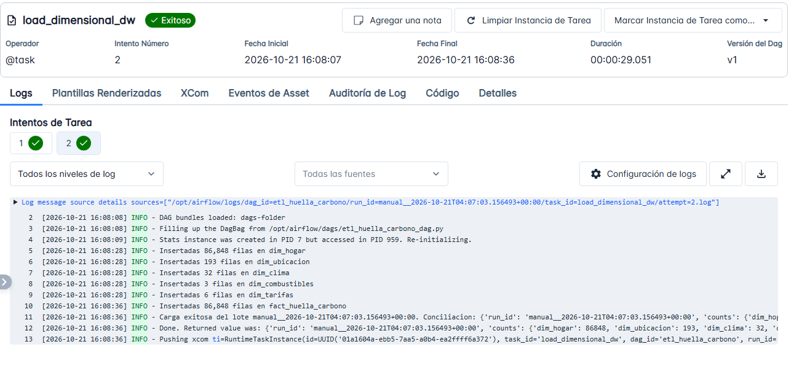

**Resultado.** Los conteos del DW son idénticos a los de la Prueba A, y `etl_audit_log` muestra las dos cargas del mismo lote, cada una con las 6 tablas en `SUCCESS` y las mismas filas cargadas (las horas están en UTC):

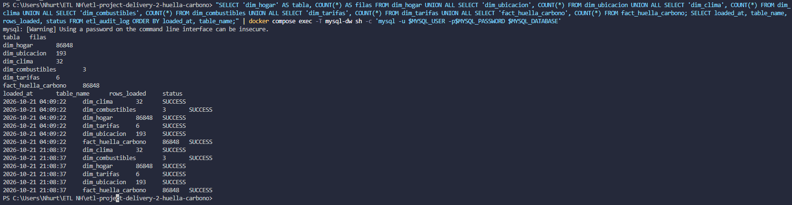

| Carga | Hora (UTC) | Tablas | Estado |
|---|---|---|---|
| Intento 1 | 2026-10-21 04:09:22 | 6 | SUCCESS |
| Intento 2 (repetición) | 2026-10-21 21:08:37 | 6 | SUCCESS |

**Interpretación.** Repetir la carga sobre el mismo lote no duplica ni pierde datos: `dim_hogar` y `fact_huella_carbono` siguen en 86.848 filas. Eso se debe a que la carga borra y reinserta dentro de una transacción con llaves deterministas, y a que la conciliación verifica los conteos antes de confirmar.

**Prueba C-2 — Falla a mitad de la carga (rollback demostrado en Docker).** La Prueba C comprueba la repetición. Esta prueba comprueba el otro caso que pide la guía: cómo se comporta el diseño cuando la carga se rompe **después** de haber borrado e insertado datos.

*Cómo se provoca, sin tocar el código.* Con `root` (el administrador de la base; el pipeline solo usa el usuario de aplicación) se crea un *trigger* temporal en la tabla de hechos que rechaza cualquier inserción. La carga borra todo, inserta las cinco dimensiones y falla al insertar la primera fila de hechos:

```
"CREATE TRIGGER trg_prueba_rollback BEFORE INSERT ON fact_huella_carbono FOR EACH ROW SIGNAL SQLSTATE '45000' SET MESSAGE_TEXT = 'Falla simulada para la prueba de rollback';" | docker compose exec -T mysql-dw sh -c 'mysql -u root -p$MYSQL_ROOT_PASSWORD $MYSQL_DATABASE'
```

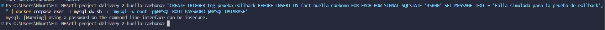

Luego se dispara el DAG con datos reales (`ecv_source = raw`). Corrida `manual__2026-10-21T22:11:02.143248+00:00`:

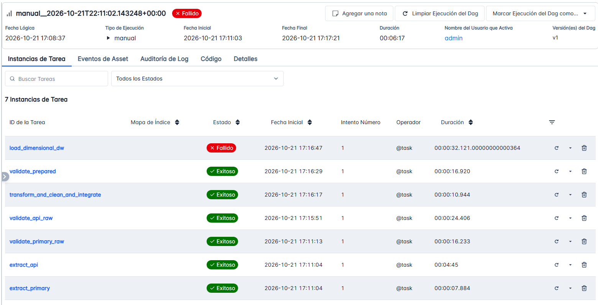

`extract_primary`, `extract_api`, `validate_primary_raw`, `validate_api_raw`, `transform_and_clean_and_integrate` y `validate_prepared` terminan en Éxito. `load_dimensional_dw` termina en **Fallido en el intento 1**, sin reintentos.

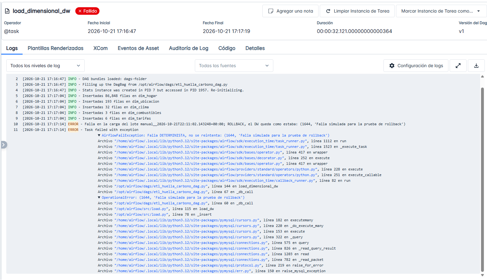

El log muestra la secuencia: insertó 86.848 filas en `dim_hogar` y 193, 32, 3 y 6 en las otras dimensiones, y después:

```
ERROR - Falla en la carga del lote manual__2026-10-21T22:11:02.143248+00:00; ROLLBACK,
el DW queda como estaba: (1644, 'Falla simulada para la prueba de rollback')
AirflowFailException: Falla DETERMINISTA, no se reintenta: (1644, ...)
```

*Resultado en el Data Warehouse.* Conteo en MySQL después de la falla:

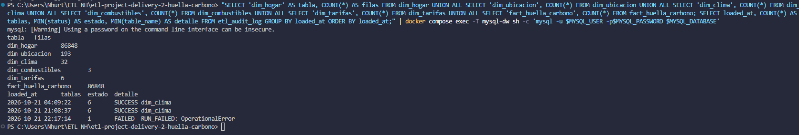

| Tabla | Filas antes de la prueba | Filas después de la falla |
|---|---|---|
| `dim_hogar` | 86.848 | 86.848 |
| `dim_ubicacion` | 193 | 193 |
| `dim_clima` | 32 | 32 |
| `dim_combustibles` | 3 | 3 |
| `dim_tarifas` | 6 | 6 |
| `fact_huella_carbono` | 86.848 | 86.848 |

`etl_audit_log` conserva las dos cargas buenas anteriores (6 tablas, `SUCCESS`) y suma **una** fila del intento fallido (`FAILED`, detalle `RUN_FAILED: OperationalError`, 2026-10-21 22:17:14 UTC), escrita en una conexión aparte después del rollback.

*Interpretación.*
- Cuando la falla llegó, la transacción ya había ejecutado los `DELETE` de todas las tablas y los `INSERT` de las cinco dimensiones. Aun así, el DW quedó con exactamente los mismos conteos: el `ROLLBACK` deshizo todo, y no quedó una carga parcial.
- El error 1644 es de datos o de la regla del servidor, no de conexión. `is_transient` lo clasifica como **determinista**, así que Airflow no gasta reintentos que repetirían el mismo error (política de la sección 17, fila "Error de esquema o de datos en la carga").
- La falla queda **visible y auditada**: tarea en rojo, log con la causa y una fila `FAILED` en `etl_audit_log`.

*Limpieza.* El trigger se eliminó al terminar (`DROP TRIGGER trg_prueba_rollback;`) y `SHOW TRIGGERS` quedó vacío:

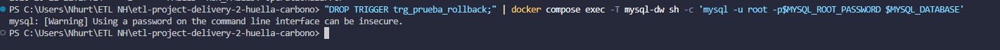

Para reproducir la prueba: crear el trigger con el comando de arriba, disparar el DAG, revisar y **quitar el trigger** antes de volver a usar el pipeline:

```
"DROP TRIGGER trg_prueba_rollback;" | docker compose exec -T mysql-dw sh -c 'mysql -u root -p$MYSQL_ROOT_PASSWORD $MYSQL_DATABASE'
```

## 21. Dashboard y salidas analíticas
El producto analítico es un informe de **Power BI Desktop** (`dashboard/huella_carbono.pbix`) conectado al Data Warehouse MySQL (`localhost:3307`, base `huella_carbono_dw_v2`). Importa las seis tablas del esquema estrella con sus relaciones; **no lee CSV, respuestas crudas de la API ni archivos intermedios**. Los pasos de conexión están en [`docs/bi_dashboard_guide.md`](docs/bi_dashboard_guide.md).


*Qué demuestra:* el servidor `localhost:3307` y la base `huella_carbono_dw_v2` son el DW de la sección 15, y las tablas importadas son las del modelo de la sección 13.

**Página 1 — Huella residencial (R1 a R5).**
- Tarjetas: hogares (86.848), huella media por hogar (905 kg CO₂/año) y emisión eléctrica media (351 kg CO₂/año).
- Gráficas: R1 columnas por estrato; R2 barras por combustible de cocina; R3′ barras por estrato y tenencia de carro; R4 barras por departamento (huella per cápita); R5 líneas por tamaño del hogar.
- Filtros: estrato y departamento.


**Página 2 — Valor de la API del IDEAM (R6 y R7).**
- Tarjetas: hogares con clima emparejado (85.339, 98,3 %), kWh/mes en piso cálido contra frío (143,6 contra 118,0, es decir +21,7 %) y diferencia de CO₂ eléctrico (+67,5 kg/año por hogar).
- Gráficas: R6 columnas de kWh por estrato y piso térmico; R7 dispersión de temperatura departamental contra porcentaje de hogares con ventilador y con aire acondicionado (un punto por departamento).
- Filtros: departamento (permite ver los resultados sin Arauca, decisión D-05) y piso térmico.


**Requisito → elemento del DW → visualización → valor de la integración.**

| Req. | Elemento del DW o consulta | KPI o visualización | Valor de la integración demostrado |
|---|---|---|---|
| R1 | `fact_huella_carbono` + `dim_ubicacion`; consulta R1 de [`sql/analytical_queries.sql`](sql/analytical_queries.sql) | Columnas por estrato (kWh y kg CO₂) | No usa la API |
| R2 | `fact_huella_carbono` + `dim_combustibles`; consulta R2 | Barras por combustible de cocina | No usa la API |
| R3′ | `fact_huella_carbono` + `dim_hogar` + `dim_ubicacion`; consulta R3 | Barras por estrato y tenencia de carro | No usa la API |
| R4 | `fact_huella_carbono` + `dim_ubicacion` + `dim_hogar` (personas); consulta R4 | Barras por departamento (huella per cápita) | No usa la API |
| R5 | `fact_huella_carbono` + `dim_hogar`; consulta R5 | Líneas por tamaño del hogar (huella per cápita) | No usa la API |
| R6 | `fact_huella_carbono` + `dim_clima` (**API**) + `dim_ubicacion`; consulta R6 | Tarjetas de kWh y CO₂ cálido contra frío; columnas por estrato y piso térmico | **Sin la API no existe `dim_clima`**: no habría piso térmico y la pregunta no tendría respuesta |
| R7 | `dim_hogar` (`P1077S11`, `P1077S12`) + `dim_clima` (**API**); consulta R7 | Dispersión temperatura contra % de hogares con ventilador y con aire acondicionado | **Sin la API** no se podría ordenar ni comparar los departamentos por temperatura |

La tarjeta "hogares con clima emparejado" (98,3 %) y las visualizaciones de R6 y R7 son el **KPI y las gráficas que demuestran el valor de integrar la API**: dependen por completo de `dim_clima`, que solo existe por la fuente del IDEAM.

*Alternativa sin Power BI:* `python scripts/dashboard_bi.py` genera una página HTML con los mismos cálculos directamente desde MySQL. Sirve para revisar rápido, pero **la solución evaluada es el informe de Power BI**.

## 22. Trazabilidad requisito → KPI de extremo a extremo
**Parte A — Requisito → consulta → resultado → visualización.** Todos los números salen del Data Warehouse tras la corrida final (sección 18). Las consultas están en [`sql/analytical_queries.sql`](sql/analytical_queries.sql).

| Req. | Consulta | Resultado principal | Visualización y evidencia |
|---|---|---|---|
| R1 | R1 | El consumo eléctrico baja de 137–139 kWh/mes (estratos 1 y 2) a 94 kWh (estrato 6), y la huella eléctrica de 363–367 a 248 kg CO₂/año. Aun así, la huella total sube de 853 (estrato 1) a 1.254 kg/año (estrato 6), así que lo que crece es la componente de cocina. Los estratos 0 (12 hogares) y 6 (36 hogares) tienen pocos hogares | Página 1 del dashboard |
| R2 | R2 | GLP 994 kg/año de cocina, gas natural 436, leña 0 (carbono neutra, D-04) | Página 1; [captura por combustible](docs/evidence/r2_lena_carbono_neutro.png) |
| R3′ | R3 | A igual estrato, los hogares **con** carro tienen mayor huella que los que no: estrato 1, 1.300 contra 818 kg; estrato 2, 1.249 contra 911; estrato 3, 1.183 contra 899; estrato 4, 1.331 contra 1.006; estrato 5, 1.492 contra 972; estrato 6, 1.402 contra 1.180. Global: 1.258 contra 867 | Página 1 |
| R4 | R4 | Mayor huella per cápita: San Andrés 696, Amazonas 487, Antioquia 429, Caldas 427 y Arauca 406 kg/año. Menor: Vaupés 121, La Guajira 221 y Sucre 254 | Página 1 |
| R5 | R5 | La huella per cápita baja de 802 kg (hogares de 1 persona) a 477 (2), 312 (3), 231 (4) y 102 (8). La huella total del hogar casi no cambia entre 2 y 8 personas (815–954 kg), así que la curva refleja economías de escala | Página 1 |
| R6 | R6 | A igual estrato, los hogares de departamentos cálidos consumen más kWh que los de departamentos fríos en los seis estratos (7 % a 38 %); global: 143,6 contra 118,0 kWh (+21,7 %) y 379,1 contra 311,6 kg CO₂/año | Página 2; capturas de la sección 6 |
| R7 | R7 | El porcentaje de hogares con ventilador y con aire acondicionado sube con la temperatura: ventilador 71,8 % (cálido), 31,9 % (templado) y 19,6 % (frío); aire acondicionado 9,3 %, 2,3 % y 2,2 % | Página 2; capturas de la sección 6 |

*Qué cambió frente a la primera entrega.*
- **R3′:** el resultado "contraintuitivo" de la primera entrega (los hogares sin carro con mayor huella: 1.232 contra 1.030 kg) venía de la leña. Los hogares sin carro cocinan más con leña y el factor completo inflaba su huella. Con la leña como carbono neutra, el resultado es el esperado. Esto es una interpretación respaldada por el cambio de resultado, no una prueba causal.
- **R4:** los departamentos que lideraban (Vichada, Guainía, Amazonas y Vaupés) eran los que más cocinan con leña. Ahora Vaupés, La Guajira y Sucre quedan al final, en parte por esa misma convención.
- **R5:** la relación inversa se mantiene, con valores más bajos que en la primera entrega (1.000 a 243 kg).
- Los valores absolutos de R1 a R5 no son comparables con los de la primera entrega por las correcciones D-04 y D-06 (sección 24). R4 usa las personas de la muestra, sin factores de expansión de la ECV: describe la muestra, no la población nacional.

**Parte B — Cadena de extremo a extremo (filas representativas).** Cada fila sigue el recorrido requisito, dato requerido, fuente, riesgo de calidad, regla, Expectation de Great Expectations, transformación, elemento del DW y visualización. Todas las reglas están en [`docs/quality_rules.md`](docs/quality_rules.md) y en `src/validation.py`. Respuesta del pipeline: **Critical** bloquea la tarea, **Warning** se registra y continúa (sección 17).

| Req. | Dato requerido y fuente | Riesgo de calidad | Regla (severidad) | Expectation de GX | Transformación o integración | Elemento del DW | Visualización |
|---|---|---|---|---|---|---|---|
| R6, R7 | `P1_DEPARTAMENTO` (ECV vivienda) | Departamento nulo o inválido: el hogar no se puede cruzar con el clima | DQ07 y DQ08 (Critical) | `ExpectColumnValuesToNotBeNull` y `ExpectColumnValuesToBeInSet` sobre `P1_DEPARTAMENTO` | Llave de integración: código DANE | `fact_huella_carbono.fk_clima`, `dim_ubicacion` | R6 y R7 (página 2) |
| R6, R7 | `departamento` (API IDEAM) | Estaciones sin departamento: no aportan a `dim_clima` | DQ14 (Critical, ≥ 99 %) | `ExpectColumnValuesToNotBeNull(departamento, mostly=0.99)` | Normalización del nombre y traducción a código DANE con `dane_departamentos.csv` | `dim_clima.codigo_departamento` | R6 y R7 |
| R6, R7 | `minimo` y `maximo` de temperatura (API) | Fallas de sensor (el IDEAM no validó los valores) | DQ15 (Critical, ≥ 99,5 %) | `ExpectColumnValuesToBeBetween(-15, 50, mostly=0.995)` | Se excluyen filas fuera de rango; promedio por departamento ponderado por lecturas | `dim_clima.temp_media_c`, `piso_termico` | R6 y R7 |
| R6, R7 | Cobertura de departamentos (API) | Departamentos sin estaciones dejan hogares sin clima | DQ17 (Warning, ≥ 30; decisión D-03) | `ExpectColumnUniqueValueCountToBeBetween(min_value=30)` | Hogares sin clima: `fk_clima` NULL y `clima_emparejado = 0` (D-02, Vaupés) | `fact_huella_carbono.clima_emparejado` | Tarjeta "hogares con clima" (98,3 %) |
| R1, R6 | `P5018`, pago de energía (ECV servicios) | Muchos valores nulos: la imputación dominaría el KPI | DQ04 (Warning, ≥ 70 %) | `ExpectColumnValuesToNotBeNull(P5018, mostly=0.70)` | Imputación con la mediana del estrato, truncado al percentil 99 y kWh = pago ÷ tarifa (S1, S2) | `fact_huella_carbono.kwh_consumidos_estimados` | R1 y R6 |
| R3′ | `P1077S15`, carro particular (ECV condiciones) | Código fuera de {1, 2} | DQ10 (Critical) | `ExpectColumnValuesToBeInSet(P1077S15, [1, 2])` | 1 → Sí, 2 → No | `dim_hogar.tiene_vehiculo` | R3′ (página 1) |
| R7 | `P1077S11` aire acondicionado y `P1077S12` ventilador (ECV condiciones) | Código fuera de {1, 2} | DQ11 (Warning) | `ExpectColumnValuesToBeInSet(P1077S11 y P1077S12, [1, 2])` | 1 → Sí, 2 → No | `dim_hogar.bien_p1077s11`, `bien_p1077s12` | R7 (página 2) |
| R1–R7 | Un hogar por fila (hechos) | Duplicados: doble conteo de emisiones | DQ19 (Critical) | `ExpectColumnValuesToBeUnique(sk_fact y fk_hogar)` | Una fila de hechos por hogar; llaves sustitutas | `fact_huella_carbono` (grano: un hogar) | Todas las tarjetas y gráficas |
| R1–R7 | Emisiones y huella (hechos) | Valores negativos o huella menor que sus componentes | DQ22 y DQ23 (Critical) | `ExpectColumnValuesToBeBetween(min 0)` y `ExpectColumnPairValuesAToBeGreaterThanB` | Cálculo de emisiones (S3, S8, S9) | `emisiones_energia_kg`, `emisiones_coccion_kg`, `huella_total_anual_kg` | Todas |

La tabla completa de reglas (DQ01 a DQ30) y los resultados de validación de cada corrida están en [`docs/quality_rules.md`](docs/quality_rules.md) y `gx/validation_results/<run_id>/`.

## 23. Instrucciones de instalación y ejecución
**Requisitos:** Docker Desktop (con Docker Compose) y unos 5 GB libres. No hace falta instalar Python ni MySQL en el equipo.

1. Clonar el repositorio.
2. Copiar `.env.example` a `.env` y reemplazar las contraseñas (sin los caracteres `@ : /`). `MYSQL_USER` puede cambiarse; la base y el usuario se crean con los valores del `.env`. El archivo `.env` no se versiona.
3. Descargar los CSV de la ECV 2025 desde https://microdatos.dane.gov.co/index.php/catalog/905 y dejarlos en `data/raw/ecv/` (no se versionan por su tamaño). El pipeline usa cuatro capítulos: "Datos de la vivienda", "Servicios del hogar", "Características y composición del hogar" y "Condiciones de vida del hogar y tenencia de bienes".
4. Construir y arrancar:
   ```
   docker compose build
   docker compose up airflow-init
   docker compose up -d
   ```
5. Abrir Airflow en http://localhost:8080 (usuario y contraseña de `.env`), activar y disparar el DAG `etl_huella_carbono` con el parámetro `ecv_source = raw`. Una corrida completa tarda unos 2 a 3 minutos.
6. El Data Warehouse MySQL queda en `localhost:3307` (base `huella_carbono_dw_v2`) para SQL y para el dashboard. Para comprobar la carga:
   ```
   "SELECT COUNT(*) FROM fact_huella_carbono;" | docker compose exec -T mysql-dw sh -c 'mysql -u $MYSQL_USER -p$MYSQL_PASSWORD $MYSQL_DATABASE'
   ```
   Debe dar 86.848.
7. Dashboard: abrir `dashboard/huella_carbono.pbix` en Power BI Desktop (necesita el conector de MySQL, *MySQL Connector/NET*) o crearlo siguiendo [`docs/bi_dashboard_guide.md`](docs/bi_dashboard_guide.md). Servidor `localhost:3307`, base `huella_carbono_dw_v2`, usuario y contraseña del `.env`.
8. Opcional, antes de correr: `python scripts/verificar_cobertura_api.py` para revisar la cobertura de estaciones del IDEAM.

*Configuración opcional.* `BIOMASS_CO2_NEUTRAL=0` en `.env` restaura el factor completo de CO₂ para la leña (decisión D-04). Con el valor por defecto (`1`) la leña cuenta como carbono neutra.

*Nota sobre consultas desde PowerShell:* los textos con tilde (por ejemplo `'Sí'`) se pueden estropear al enviarlos por la tubería. Las consultas del repositorio ya evitan esa dependencia.

## 24. Supuestos y limitaciones

- Los kWh de la ECV son estimados desde el pago y la tarifa; no son consumo medido y el pago refleja subsidios.
- La temperatura se promedia por departamento y oculta diferencias internas (por altitud, por ejemplo). Arauca, Guainía y Guaviare tienen una sola estación del IDEAM; su temperatura depende de un único punto. En Arauca el resultado (10,2 °C) es inconsistente con su clima y con su tenencia de ventiladores; se conserva y se reporta con y sin Arauca (decisión D-05, supuesto S16).
- **Vaupés no tiene datos de temperatura** y queda fuera de R6 y R7 (≈1,7 % de los hogares). Se declara como ausencia (NULL), no como 0 °C (decisión D-02).
- Con 33 departamentos, la relación temperatura–consumo es una asociación, no una causa.
- El IDEAM no validó los valores publicados (aviso de la ficha del dataset).
- Los precios de combustible de cocina siguen siendo fijos (limitación de la primera entrega, no resuelta en esta).
- **Leña (supuesto S9, decisión D-04):** la tabla de factores del proyecto marca la leña como carbono neutra ("no suma al total neto de CO₂, sí contabiliza CH₄ y N₂O"), y el IPCC (2006) respalda la convención: el CO₂ de la biomasa no se incluye en los totales. El pipeline lo aplica: el CO₂ de la leña se cuenta como 0 en la huella neta (`BIOMASS_CO2_NEUTRAL=1`, reversible con `0`). Esto **corrige la primera entrega**, que sumaba el factor completo (112.000 kg/TJ): el hallazgo original de R2 ("la leña emite 3 veces más") ya no se sostiene. Limitaciones: no se incluyen CH₄ ni N₂O (el IPCC da factores por defecto, 300 y 4 kg/TJ para leña residencial, pero la huella del proyecto se define como CO₂ y agregarlos exigiría aplicarlos a todos los combustibles; equivale a ≈8,4 kg de CH₄ y ≈0,11 kg de N₂O por hogar con leña y año), y la neutralidad supone cosecha sostenible, algo que la ECV no permite verificar.
- **Factor de emisión eléctrica (supuesto S3, decisión D-06):** la primera entrega usaba 0,097 kg CO₂/kWh, un valor atribuido a XM cuyo origen no se pudo verificar. La UPME publica el factor del SIN para inventarios y huellas de carbono: 0,177 en 2023 y **0,220 en 2024**. Esta entrega usa **0,220**, el dato oficial más cercano al periodo de la ECV (agosto 2024 a noviembre 2025). Esto **corrige la primera entrega**: las emisiones eléctricas y las huellas totales son ≈2,3 veces mayores en valor absoluto, mientras que los kWh y las comparaciones porcentuales no cambian. El factor es un promedio anual constante (no se modela variación mensual).
- **Efecto combinado de D-04 y D-06:** la huella media por hogar pasa de ≈1.213 kg/año (primera entrega) a ≈905 (−505 por la leña neutra y +196 por el factor eléctrico); un hogar con leña pasa de ≈3.253 a ≈245. Por eso los valores absolutos de R2 a R5 de la primera entrega no son comparables con los de esta (sección 22).
- **Supuestos sin fuente oficial.** Siguen sin respaldo documental el uso de tarifas fijas por estrato (S1), el precio del gas natural (S4), el precio del GLP (S5), el poder calorífico del gas natural (parte de S6) y el consumo de 150 kg de leña por mes (S7, el más fuerte porque no depende del gasto del hogar). Los subsidios de S2 tienen solo una fuente secundaria (prensa). Se declaran en [`docs/supuestos_y_trazabilidad.md`](docs/supuestos_y_trazabilidad.md). En cambio, los factores de emisión de combustibles (S8), el poder calorífico de leña y GLP (S6) y el factor eléctrico (S3) tienen fuente oficial.
- **Solo CO₂.** La huella se mide en kg de CO₂, no en CO₂ equivalente: no incluye CH₄ ni N₂O.
- **Muestra, no población.** Las cifras describen los 86.848 hogares de la muestra de la ECV. El pipeline no aplica factores de expansión, así que no son totales nacionales.

## 25. Integrantes y responsabilidades

| Integrante | Rol |
|---|---|
| Nikol Hurtado | Persona 1 — Infraestructura y orquestación |
| David Aponte | Persona 2 — API y calidad de datos |
| Diana Panesso | Persona 3 — Transformación, integración y modelo |
| Sebastián Celorio | Persona 4 — Analítica, dashboard y documentación |