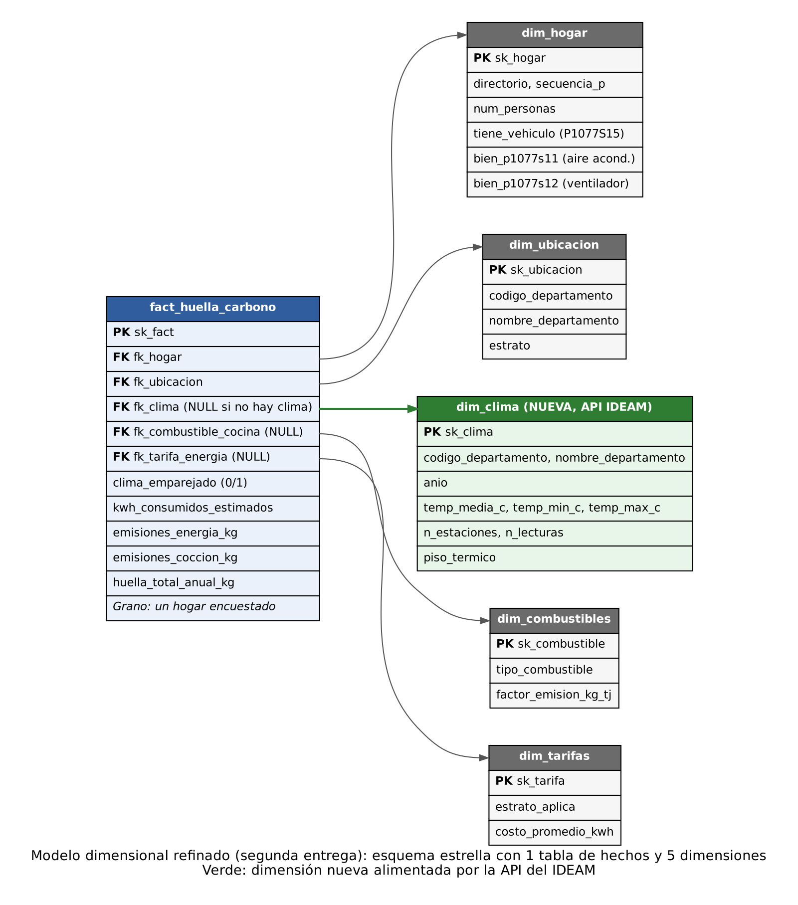

# ETL Segunda Entrega — Huella de Carbono en Hogares Colombianos (ODS 12)

**Curso:** ETL (G01) · Universidad Autónoma de Occidente · Ingeniería de Datos e Inteligencia Artificial

> **Estado del README:** esqueleto con las 25 secciones que exige el enunciado. Cada sección indica
> responsable y estado. Lo marcado **PENDIENTE** debe completarse con evidencia real (capturas legibles
> con su interpretación, resultados de GX, conteos). No se escribe nada que no esté respaldado por evidencia.

## 1. Problema y objetivo analítico
> Responsable: Persona 4 · Estado: pendiente (reutilizar la fase 1)

Estimar y caracterizar la huella de carbono residencial de los hogares colombianos (ODS 12) con la ECV 2025 del DANE
y, en esta entrega, explicar parte de la variación del consumo eléctrico con la temperatura oficial del IDEAM.

## 2. Línea base de la Primera Entrega y enlace al repositorio
> Responsable: Persona 4 · Estado: parcial

Repositorio de la primera entrega (se conserva intacto): https://github.com/dianapanesso/etl-proyecto-huella-carbono

PENDIENTE: resumen de la línea base y modelo dimensional previo (copiar `docs/star_schema.png` a `docs/evidence/`).

## 3. Estado y cambios de R1–R5
> Responsable: Persona 4 · Estado: propuesta pendiente de confirmación

| Req. | Estado | Cambio | Justificación |
|---|---|---|---|
| R1 | Refinar | Se puede ver por estrato y por piso térmico (columna nueva en `dim_ubicacion`) | Puente con R6; no cambia el cálculo |
| R2 | Mantener | Ninguno | Los precios fijos de combustible quedan como limitación documentada |
| R3 | Mantener | Ninguno | Sigue midiendo asociación, no emisiones de transporte |
| R4 | Mantener | Ninguno | |
| R5 | Mantener | Ninguno | |

## 4. Requisitos integrados R6 y R7
> Responsable: Persona 4 · Estado: borrador

| ID | Requisito | Datos ECV | Datos API | Llave | KPI | Detalle |
|---|---|---|---|---|---|---|
| R6 | ¿Cuántos kWh/mes y kg CO₂ eléctrico más generan los hogares de departamentos cálidos que los de templados o fríos, a igual estrato? | `P5018`, `P5010`, departamento, tarifa | Temperatura media 2025 por departamento | Departamento (DANE) | kWh/mes y kg CO₂/año por piso térmico y estrato; correlación temperatura–kWh | Departamento × estrato |
| R7 | ¿El % de hogares con aire acondicionado o ventilador sube con la temperatura del departamento, y cuánto CO₂ eléctrico extra tienen? | `P1077S11`, `P1077S12` (confirmar significado en el diccionario DANE), huella eléctrica | Temperatura media 2025 por departamento | Departamento (DANE) | % de hogares con equipo vs temperatura; diferencia de kg CO₂ | Departamento |

## 5. Fuente primaria y fuente API
> Responsable: Persona 2 · Estado: parcial

**Fuente primaria:** ECV 2025 (DANE), 4 capítulos en CSV (`data/raw/ecv/`): Servicios del hogar, Datos de la vivienda,
Características y composición del hogar, Condiciones de vida del hogar y tenencia de bienes (se excluye el capítulo "(programas)").

**API (sección 4.1 del enunciado):**

| Ítem | Documentación |
|---|---|
| Proveedor y propósito | Instituto de Hidrología, Meteorología y Estudios Ambientales (IDEAM). Dataset "Temperatura Ambiente del Aire" en datos.gov.co (id `sbwg-7ju4`): lecturas horarias de estaciones del IDEAM |
| Valor analítico | Aporta clima oficial por departamento, que la ECV no tiene; sin él no se pueden responder R6 ni R7 |
| Endpoint y parámetros | `https://www.datos.gov.co/resource/sbwg-7ju4.json` (SODA). Filtro `codigosensor='0068'` (Temp Aire 2 m, °C). Ventanas de fechas con `$where`, agregación en el servidor con `$select`, `$group`, `$order`, `$limit`, `$offset` |
| Respuesta | JSON (lista de objetos). Se conservan: estación, departamento, municipio, latitud, longitud, suma, conteo, mínimo y máximo por ventana |
| Autenticación | Sin autenticación obligatoria; token de aplicación opcional en la cabecera `X-App-Token` (variable `DATOS_GOV_APP_TOKEN`, nunca en el repositorio) |
| Comportamiento operativo | Páginas de hasta 50 000 filas; reintentos por ventana ante timeout, red, HTTP 429/5xx; error 4xx se trata como falla determinista; sello de tiempo en `api_manifest.json` |
| Reproducibilidad | `docker compose up` + disparar el DAG; otro evaluador usa las mismas fechas (`.env.example`). Licencia CC BY-SA 4.0 (fuente: IDEAM) |

Aviso de la ficha del dataset: el IDEAM no validó los valores publicados y pueden existir errores por fallas de sensor (base de las reglas DQ15 y DQ17).

## 6. Valor analítico aportado por la API
> Responsable: Persona 4 · Estado: PENDIENTE

## 7. Arquitectura del sistema
> Responsable: Persona 4 · Estado: PENDIENTE (diagrama en `docs/`; debe incluir fuentes, raw por rama, compuertas, transformación, DW, SQL/dashboard y Airflow)

## 8. Hallazgos de perfilamiento
> Responsable: Persona 2 · Estado: PENDIENTE (notebooks reproducibles en `notebooks/`, con tablas y su interpretación; ECV y API)

## 9. Riesgos y reglas de calidad
> Responsable: Persona 2 · Estado: borrador — ver [`docs/quality_rules.md`](docs/quality_rules.md)

## 10. Diseño de Great Expectations y trazabilidad de reglas
> Responsable: Persona 2 · Estado: parcial

| Elemento GX | Implementación |
|---|---|
| Objeto de datos | DataFrame del lote raw de cada tabla ECV y de la API |
| Expectation | Una por regla; el ID de la regla va en `meta.rule_id` |
| Suite | `ecv_servicios_raw_suite`, `ecv_vivienda_raw_suite`, `ecv_caracteristicas_raw_suite`, `ecv_condiciones_raw_suite`, `api_ideam_raw_suite` (exportadas a `gx/expectations/`) |
| Validation Definition | Batch del DataFrame + suite (`src/validation.py: run_suite`) |
| Ejecución controlada | Tareas `validate_*` del DAG |
| Resultado | `gx/validation_results/<run_id>/<suite>.json` (copias de las corridas A y B en `docs/evidence/`) |
| Respuesta del pipeline | Critical bloquea (la tarea falla); Warning se registra y continúa; Info solo monitoreo |

## 11. Diseño de validación raw de ambas fuentes
> Responsable: Persona 2 · Estado: parcial (ver sección 10 y `src/validation.py`)

## 12. Estrategia de transformación y contrato de integración
> Responsable: Persona 3 · Estado: completado

La estrategia de integración une los microdatos de la ECV con los datos climáticos del IDEAM utilizando el departamento como eje geográfico. El cruce se realiza en memoria mediante Pandas durante la transformación, garantizando la calidad antes de la carga a MySQL.

**Contrato de Integración:**
*   **Llave ECV:** `P1_DEPARTAMENTO` (código DANE numérico), extraído del capítulo "Datos de la vivienda".
*   **Llave API:** `departamento` (texto del IDEAM), el cual se normaliza (minúsculas, sin tildes ni puntuación) y se traduce al código DANE usando el diccionario `data/reference/dane_departamentos.csv` (incluyendo alias como Bogotá y San Andrés).
*   **Cardinalidad:** Muchos a uno (N:1). Muchos hogares se asocian a 1 única fila de clima por departamento.
*   **Alineación temporal:** Ambas fuentes corresponden a ventanas temporales del año 2025.
*   **Tratamiento de no emparejados:** 
    *   Hogares en un departamento sin estaciones del IDEAM: Quedan con `fk_clima` en NULL y bandera `clima_emparejado = 0`. Se conservan para responder R1 a R5, pero se excluyen de R6 y R7.
    *   Departamentos del IDEAM sin código DANE: Se descartan y se reportan en la bitácora.
*   **Tratamiento de duplicados:** Se agrupan múltiples estaciones por departamento calculando un promedio ponderado por el número de lecturas. Filas con temperaturas fuera del rango físico plausible (ej. < -15°C o > 50°C) se excluyen.
*   **Supuestos de negocio (S14):** Los cortes de piso térmico se establecieron en: Cálido (>24°C), Templado (18°C - 24°C) y Frío (<18°C). El promedio departamental resume el clima de las estaciones, asumiendo que representa la región.

**Evidencia de Transformación (Antes y Después):**
> *Nota para el equipo: Los resultados de los conteos finales de la integración (cuántos hogares cruzaron y cuántos no) se generan automáticamente en el archivo `data/work/<run_id>/prepared/integration_report.json` al ejecutar el DAG. Pegar los resultados aquí tras la corrida de prueba.*

## 13. Modelo dimensional refinado y justificación de cambios
> Responsable: Persona 3 · Estado: completado



**Grano del modelo:** 
Una fila en la tabla de hechos (`fact_huella_carbono`) representa la estimación del consumo eléctrico y la huella de carbono anual de **un (1) hogar encuestado** en la ECV 2025.

**Bitácora de cambios frente a la Fase 1:**
Para poder dar respuesta a los nuevos requerimientos analíticos solicitados para el ODS 12 (R6 y R7), el esquema estrella de la primera entrega fue refinado mediante:
1.  **Creación de `dim_clima`:** Una nueva dimensión que almacena la temperatura media departamental (`temp_media_c`) y la categorización cualitativa del clima (`piso_termico`: Cálido, Templado, Frío).
2.  **Actualización de `fact_huella_carbono`:** Se agregó la llave foránea `fk_clima` a la tabla central para vincular cada hogar con las condiciones climáticas de su ubicación.

**Validación de Requisitos (R1 - R7):**
El modelo actualizado mantiene plena compatibilidad con los requerimientos originales, permitiendo cruzar las emisiones con el estrato (`dim_ubicacion`), combustible (`dim_combustibles`) y características del hogar (`dim_hogar`). Además, el nuevo modelo valida con éxito la expansión analítica al permitir cruzar el consumo eléctrico y las emisiones contra la nueva `dim_clima` para responder a las preguntas R6 y R7.

## 14. Validación de datos preparados
> Responsable: Personas 2 y 3 · Estado: PENDIENTE (tarea `validate_prepared`)

## 15. Implementación y carga del Data Warehouse
> Responsable: Persona 3 · Estado: PENDIENTE (`sql/`, `src/load.py`; MySQL 8, conciliación de conteos)

## 16. Diseño del DAG de Airflow e interfaces de las tareas
> Responsable: Persona 1 · Estado: esqueleto listo (`dags/etl_huella_carbono_dag.py`)

```
extract_primary -> validate_primary_raw ----\
                                             >-> transform_and_clean_and_integrate -> validate_prepared -> load_dimensional_dw
extract_api     -> validate_api_raw --------/
```

| Tarea | Entrada | Salida | Identidad del lote | Señal de falla | Re-ejecución |
|---|---|---|---|---|---|
| extract_primary | parámetro `ecv_source` | rutas raw + `ecv_manifest.json` | `run_id` | excepción (archivo o columna faltante) | rescribe `data/work/<run_id>/` |
| extract_api | fechas de `.env` | `api_ideam_raw.csv` + `api_manifest.json` | `run_id` | `APITransientError` / `APIContractError` | reanuda: reutiliza las ventanas ya descargadas |
| validate_*_raw | ruta del lote raw | resumen de GX + JSON | `run_id` | `ValueError` si hay Critical | idempotente |
| transform_and_clean_and_integrate | rutas raw | rutas de 6 tablas preparadas + reporte de integración | `run_id` | excepción | reescribe `data/work/<run_id>/prepared/` |
| validate_prepared | rutas preparadas | resumen de GX | `run_id` | `ValueError` si hay Critical | PENDIENTE |
| load_dimensional_dw | rutas preparadas | conteos antes/después | `run_id` | excepción | PENDIENTE |

Las tareas intercambian rutas y metadatos compactos; nunca DataFrames completos por XCom.

## 17. Políticas de falla y reintentos
> Responsable: Persona 1 · Estado: borrador — justificar cantidad y espera de cada reintento con las pruebas

| Condición | Tipo | Respuesta | Reintento | Justificación |
|---|---|---|---|---|
| API caída, timeout, HTTP 429/5xx | Transitoria | Reintento por ventana (3, 5/10 s) y luego de la tarea (3, 1 min exponencial hasta 5) | Sí | La misma petición puede funcionar después |
| API responde 4xx o forma inesperada | Determinista | `AirflowFailException` | No | Repetir reproduce el error |
| MySQL no disponible, conexión cortada, deadlock | Transitoria | Reintento (3, 30 s exponencial hasta 3 min) | Sí | El servicio puede recuperarse |
| Error de esquema o de datos en la carga | Determinista | `AirflowFailException` | No | El mismo lote fallaría igual |
| Falta un archivo o columna de la ECV | Determinista | Falla de `extract_primary` | No | Reintentar no crea el archivo |
| Critical de Great Expectations | Determinista | Falla la compuerta; lo posterior no corre | No | Los datos no cambian al repetir |

## 18. Evidencia de la corrida exitosa (Prueba A)
> Responsable: Persona 1 · Estado: PENDIENTE

## 19. Evidencia de la falla controlada (Prueba B)
> Responsable: Persona 1 · Estado: PENDIENTE
> Plan: `docker compose exec airflow-scheduler python /opt/airflow/src/make_bad_data.py` y disparar el DAG con `ecv_source = test`.
> Viola la regla Critical DQ08 (código de departamento inválido, llave de integración) y bloquea `transform_*` y la carga.

## 20. Repetibilidad y estrategia de re-ejecución segura (Prueba C)
> Responsable: Personas 1 y 3 · Estado: PENDIENTE (ver estrategia sugerida en `src/load.py`)

## 21. Dashboard y salidas analíticas
> Responsable: Persona 4 · Estado: PENDIENTE (debe consultar MySQL, no CSV; al menos un KPI y una gráfica que muestren el valor de integrar la API)

## 22. Trazabilidad requisito → KPI de extremo a extremo
> Responsable: Persona 4 · Estado: PENDIENTE

## 23. Instrucciones de instalación y ejecución

1. Clonar el repositorio.
2. Copiar `.env.example` a `.env` y reemplazar las contraseñas (sin los caracteres `@ : /`).
3. Descargar los CSV de la ECV 2025 desde https://microdatos.dane.gov.co/index.php/catalog/905 y dejarlos en `data/raw/ecv/` (no se versionan por su tamaño).
4. Construir y arrancar:
   ```
   docker compose build
   docker compose up airflow-init
   docker compose up -d
   ```
5. Abrir Airflow en http://localhost:8080 (usuario y contraseña de `.env`), activar y disparar el DAG `etl_huella_carbono`.
6. El Data Warehouse MySQL queda en `localhost:3307` (base `huella_carbono_dw_v2`) para SQL y el dashboard.
7. Opcional, antes de correr: `python scripts/verificar_cobertura_api.py` para revisar la cobertura de estaciones del IDEAM.

## 24. Supuestos y limitaciones
> Responsable: Persona 4 · Estado: parcial

- Los kWh de la ECV son estimados desde el pago y la tarifa; no son consumo medido y el pago refleja subsidios.
- La temperatura se promedia por departamento y oculta diferencias internas (por altitud, por ejemplo).
- Con 33 departamentos, la relación temperatura–consumo es una asociación, no una causa.
- El IDEAM no validó los valores publicados (aviso de la ficha del dataset).
- Los precios de combustible de cocina siguen siendo fijos (limitación de la primera entrega, no resuelta en esta).

## 25. Integrantes y responsabilidades

| Integrante | Rol |
|---|---|
| Nikol Hurtado | Persona 1 — Infraestructura y orquestación |
| David Aponte | Persona 2 — API y calidad de datos |
| Diana Panesso | Persona 3 — Transformación, integración y modelo |
| Sebastián Celorio | Persona 4 — Analítica, dashboard y documentación |
